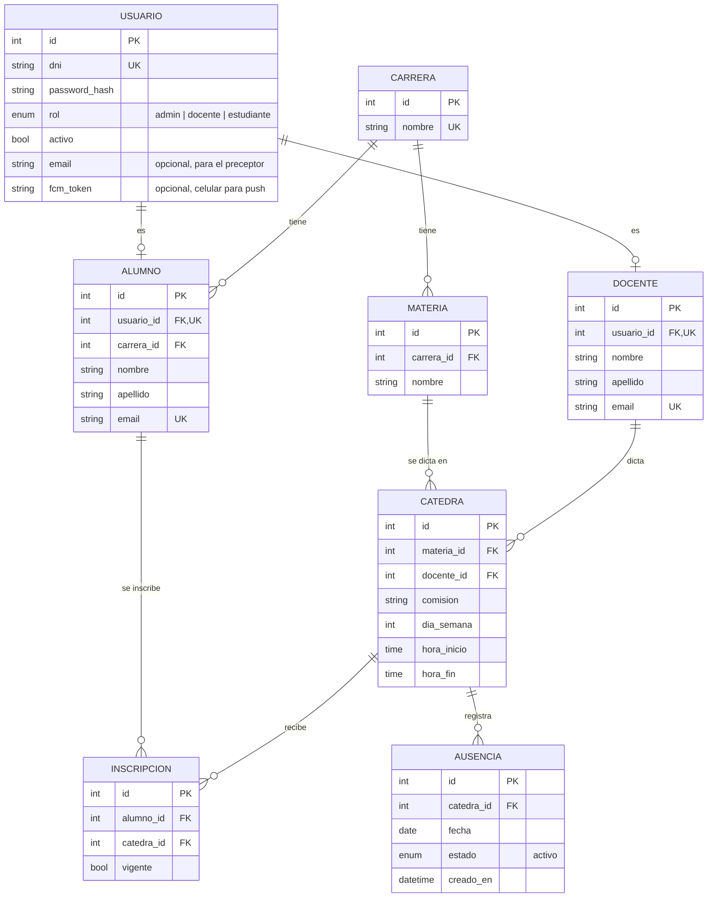

# Gestion Asist

API de **avisos de ausencia docente**: el docente avisa que no va a dar una clase concreta y los alumnos inscriptos en esa cátedra se enteran. Este repo es **solo la API**; la app Android (docentes y alumnos) y el frontend web (administrador / preceptor) son proyectos aparte.

Está construido con **FastAPI**, **SQLModel** (ORM) y **PostgreSQL**, y corre entero en **Docker**, así que funciona igual en cualquier máquina.

---

## Índice

1. [Estado del proyecto](#estado-del-proyecto)
2. [Tecnologías utilizadas](#tecnologías-utilizadas)
3. [Dependencias](#dependencias)
4. [Instalación](#instalación)
   - [Windows (con WSL2)](#windows-con-wsl2)
   - [Linux (Ubuntu / Debian)](#linux-ubuntu--debian)
   - [Opcional: correos con Gmail](#opcional-correos-con-gmail) · [Opcional: push con Firebase](#opcional-push-con-firebase)
   - [¿Quedó todo bien?](#quedó-todo-bien)
5. [Variables de entorno](#variables-de-entorno)
6. [Modelo de datos](#modelo-de-datos)
7. [API: endpoints disponibles](#api-endpoints-disponibles)
8. [Estructura de carpetas](#estructura-de-carpetas)
9. [Cómo fluye un request](#cómo-fluye-un-request)
10. [Agregar un recurso nuevo (guía)](#agregar-un-recurso-nuevo-guía)
11. [Migraciones de base de datos](#migraciones-de-base-de-datos)
12. [Tests](#tests)
13. [Comandos útiles](#comandos-útiles)
14. [Solución de problemas](#solución-de-problemas)

---

## Estado del proyecto

| HU     | Rol        | Qué                                                        | Estado |
|--------|------------|------------------------------------------------------------|--------|
| HU-01  | Todos      | Login con DNI y contraseña                                 | ✅ `/auth/login`, `/auth/me` |
| HU-02  | Docente    | Registrar aviso eligiendo una clase concreta de una lista  | ✅ `/docente/clases-disponibles`, `/docente/avisos` |
| HU-03  | Docente    | Ver el historial de sus avisos                             | ✅ `GET /docente/avisos` |
| ~~HU-04~~ | —       | Cancelar aviso: **descartada** (un aviso no se cancela ni se edita) | ❌ |
| HU-05  | Estudiante | Ver avisos de cátedras donde tiene inscripción vigente     | ✅ `GET /alumno/avisos` |
| HU-06  | Estudiante / Preceptor | Notificación push + correo al registrarse un aviso | ✅ [ver Notificaciones](#notificaciones-hu-06) |
| HU-07  | Estudiante | Ver sus inscripciones vigentes y sus avisos                | ✅ `GET /alumno/inscripciones` |
| HU-08  | Admin      | Alta de docentes y estudiantes                             | ✅ `/docentes`, `/alumnos` |
| HU-09  | Admin      | Listar avisos con filtros                                  | ✅ `GET /admin/avisos` |
| HU-10  | Admin      | Asignar docentes a materias (cátedras)                     | ✅ `/catedras` |

Además: CRUD de administrador para carreras, materias e inscripciones (necesarios para cargar los datos).

---

## Tecnologías utilizadas

| Herramienta        | Versión | Para qué se usa                                                               |
|--------------------|---------|-------------------------------------------------------------------------------|
| Python             | 3.12    | Lenguaje de la aplicación.                                                    |
| FastAPI            | 0.149   | Framework web: rutas, validación de datos y documentación automática (`/docs`). |
| SQLModel           | 0.0.48  | ORM: define las tablas como clases Python (une SQLAlchemy + Pydantic).        |
| PostgreSQL         | 17      | Base de datos relacional.                                                     |
| psycopg (v3)       | 3.3     | Driver que conecta Python con PostgreSQL.                                     |
| Alembic            | 1.20    | Migraciones: versiona los cambios en la estructura de la base.                |
| pydantic-settings  | 2.16    | Lee la configuración desde el archivo `.env`.                                 |
| Jinja2             | —       | Plantillas HTML para las páginas web (viene incluido en `fastapi[standard]`). |
| Uvicorn            | —       | Servidor que ejecuta la app (viene incluido en `fastapi[standard]`).          |
| pytest             | 9.1     | Tests automáticos.                                                            |
| Docker / Compose   | —       | Corre la app y PostgreSQL en contenedores, igual en cualquier máquina.        |

---

## Dependencias

Todas las dependencias de Python están en [requirements.txt](requirements.txt) con **versión fija**, para que todos instalen exactamente lo mismo:

```text
fastapi[standard]==0.149.0   # FastAPI + Uvicorn + Jinja2 + CLI "fastapi" + httpx (para tests)
sqlmodel==0.0.48             # ORM (trae SQLAlchemy y Pydantic)
psycopg[binary]==3.3.6       # Driver de PostgreSQL (versión precompilada, no requiere compilar nada)
alembic==1.20.0              # Migraciones
pydantic-settings==2.16.0    # Configuración desde .env
pytest==9.1.1                # Tests
pwdlib[argon2]==0.3.1        # Encriptado de contraseñas (Argon2)
pyjwt==2.15.1                # Tokens de acceso (JWT)
tzdata==2026.5               # Zonas horarias para zoneinfo (también en Windows)
firebase-admin==7.7.0        # Notificaciones push (Firebase Cloud Messaging)
```

No hace falta instalarlas a mano para correr la app: **Docker las instala solo** al construir la imagen. Solo las instalás en tu máquina (dentro de un entorno virtual) para que el editor autocomplete y para correr `alembic` y `pytest` desde la terminal (ver el paso D5 en [Windows](#windows-con-wsl2) o L9 en [Linux](#linux-ubuntu--debian)).

**Para agregar una dependencia nueva:**

1. Con el `.venv` activo: `pip install <paquete>`
2. Ver qué versión se instaló: `pip show <paquete>`
3. Agregarla a `requirements.txt` con esa versión: `<paquete>==X.Y.Z`
4. Reconstruir la imagen: `docker compose up --build`

---

## Instalación

Esta guía es para alguien que **nunca usó el proyecto**. Seguí la sección de tu sistema de principio a fin: cada una está completa.

**Qué vas a tener al final**

| Qué | Dónde |
|-----|-------|
| La API (contenedor `web`) | http://localhost:8000 · documentación interactiva en http://localhost:8000/docs |
| La base de datos PostgreSQL (contenedor `db`) | `localhost:5433` desde tu máquina. Hay **una sola base**: la del contenedor |
| Un usuario administrador tuyo y datos de prueba | Para loguearte en `/docs` |
| Un entorno virtual `.venv` | Para que el editor autocomplete y para correr los tests |

No hace falta instalar PostgreSQL: lo trae Docker.

| Si usás… | Seguí |
|----------|-------|
| Windows 10 / 11 | [Windows (con WSL2)](#windows-con-wsl2) |
| Ubuntu o Debian | [Linux (Ubuntu / Debian)](#linux-ubuntu--debian) |

Las configuraciones de [correo (Gmail)](#opcional-correos-con-gmail) y [push (Firebase)](#opcional-push-con-firebase) son **opcionales**: la app funciona sin ellas.

---

### Windows (con WSL2)

En Windows el proyecto se usa **dentro de WSL2**: un Ubuntu real que corre integrado en Windows. Docker Desktop y VS Code se instalan en Windows y trabajan con ese Ubuntu.

#### Parte A: Instalación inicial (una sola vez, fuera de VS Code)

**A1. Comprobar la versión de Windows y la virtualización**

WSL2 necesita Windows 10 versión 2004 o posterior (compilación 19041+) o Windows 11, y la virtualización del procesador activada.

1. Tecla Windows + R → escribir `winver` → Enter. Tiene que decir **Windows 11**, o **Windows 10 Versión 2004** o mayor (20H2, 21H2, 22H2…).
2. Abrir el **Administrador de tareas** (Ctrl+Shift+Esc) → pestaña **Rendimiento** → **CPU**. Abajo a la derecha tiene que decir **Virtualización: Habilitado**.

> **Si falla:**
> - Windows 10 más viejo que 2004: actualizarlo desde *Configuración → Windows Update*.
> - "Virtualización: Deshabilitado": hay que activarla en la BIOS/UEFI. Reiniciar la PC y entrar a la configuración (según la marca, tecla **F2**, **F10**, **Supr/Del** o **Esc** al encender; en Windows 11 también desde *Configuración → Sistema → Recuperación → Inicio avanzado → Opciones avanzadas → Configuración de firmware UEFI*). Buscar la opción **Intel Virtualization Technology (VT-x)** o **AMD SVM / AMD-V**, ponerla en *Enabled*, guardar y salir (normalmente F10).

**A2. Instalar WSL**

Instala WSL2 y Ubuntu.

1. Menú Inicio → escribir **PowerShell** → clic derecho en *Windows PowerShell* → **Ejecutar como administrador**.
2. Ejecutar:

   ```powershell
   wsl --install
   ```

3. Cuando termine, **reiniciar la PC**.

Si salió bien, el comando muestra que instala "Plataforma de máquina virtual", "Subsistema de Windows para Linux" y "Ubuntu", y pide reiniciar.

> **Si falla:**
> - Muestra la ayuda de `wsl` en vez de instalar: WSL ya estaba instalado. Instalar solo Ubuntu con `wsl --install -d Ubuntu`.
> - Error `0x80370102`: la virtualización está deshabilitada (ver A1).
> - Error `0x8007019e`: ejecutar `wsl --install` otra vez **como administrador** y reiniciar.

**A3. Primera apertura de Ubuntu: usuario y contraseña de Linux**

Después de reiniciar se abre sola una ventana de **Ubuntu** (si no, abrirla desde el menú Inicio → *Ubuntu*). La primera vez tarda unos minutos y pide:

```text
Enter new UNIX username: tunombre
New password:
Retype new password:
```

- El usuario: en minúsculas, sin espacios ni acentos (ej. `andres`).
- La contraseña **no se ve mientras la escribís** (ni asteriscos): es normal. Escribila y Enter.
- **Anotala**: es la que te va a pedir `sudo` cada vez que instales algo en Ubuntu. No tiene que ser la de Windows.

Si salió bien, termina en una línea como `tunombre@NOMBRE-PC:~$`.

> **Si falla:** si te equivocaste en la contraseña al repetirla, la vuelve a pedir. Si cerraste la ventana antes de terminar, abrí *Ubuntu* de nuevo desde el menú Inicio.

**A4. Verificar que Ubuntu use WSL 2**

En **PowerShell** (no hace falta que sea administrador):

```powershell
wsl -l -v
```

Tiene que verse algo así, con **VERSION 2**:

```text
  NAME      STATE           VERSION
* Ubuntu    Running         2
```

> **Si falla:**
> - Dice `VERSION 1`: convertirla con `wsl --set-version Ubuntu 2` y dejar la 2 por defecto con `wsl --set-default-version 2`.
> - No aparece Ubuntu: `wsl --install -d Ubuntu`.
> - Algún error de versión del kernel: `wsl --update` y volver a probar.

**A5. Instalar Docker Desktop**

Docker Desktop corre los contenedores de la app y de la base, y los comparte con Ubuntu.

1. Descargar e instalar **Docker Desktop for Windows** desde https://www.docker.com/products/docker-desktop/. Durante la instalación dejar marcada **Use WSL 2 instead of Hyper-V** (o similar).
2. Abrir Docker Desktop (aceptar los términos; no hace falta crear cuenta).
3. Ir a **Settings** (engranaje) → **General** → verificar que esté marcado **Use the WSL 2 based engine**.
4. **Settings → Resources → WSL Integration** → activar el interruptor de **Ubuntu** → **Apply & restart**.
5. Abrir **Ubuntu** y verificar:

   ```bash
   docker --version
   docker compose version
   docker run hello-world
   ```

Si salió bien: `Docker version 2x.x.x`, `Docker Compose version v2.x` o mayor, y `hello-world` imprime **Hello from Docker!**

> **Si falla:** ver en la [Parte E](#parte-e-problemas-comunes-en-windows) "docker: command not found" y "Docker Desktop no arranca". Docker Desktop tiene que **estar abierto** (ícono de la ballena en la barra de tareas) cada vez que uses el proyecto.

**A6. Instalar VS Code y la extensión WSL**

1. Instalar **Visual Studio Code** para Windows desde https://code.visualstudio.com/ (dejar marcada la opción **Agregar a PATH**).
2. Abrir VS Code → **Extensiones** (Ctrl+Shift+X) → buscar **WSL** (de **Microsoft**) → **Instalar**.

Si salió bien, abajo a la izquierda aparece un ícono `><` (indicador remoto).

> **Si falla:** si no encontrás la extensión, buscá por su identificador `ms-vscode-remote.remote-wsl`.

#### Parte B: Dónde escribir los comandos

Todos los comandos de las partes C y D se escriben en una **terminal de Ubuntu (WSL)**, nunca en PowerShell ni en CMD. Hay dos formas equivalentes de abrirla:

**Opción 1 (recomendada): terminal de VS Code conectada a WSL**

1. En VS Code: **F1** → escribir **WSL: Connect to WSL** → Enter. Se abre una ventana nueva.
2. Abajo a la izquierda tiene que decir **WSL: Ubuntu**.
3. Abrir la terminal: menú **Terminal → Nueva terminal** (o **Ctrl+`**; en teclado español suele ser **Ctrl+ñ**). El prompt se ve como `tunombre@NOMBRE-PC:~$`.

> ⚠️ Si abajo a la izquierda **no** dice *WSL: Ubuntu*, esa terminal es de **Windows** (PowerShell) y los comandos van a fallar.

**Opción 2: la app Ubuntu**

1. Menú Inicio → **Ubuntu**.
2. Más adelante, para abrir el proyecto en VS Code, desde esa terminal: `code .` (lo abre ya conectado a WSL).

Desde acá, **todos los comandos son iguales en las dos opciones**.

#### Parte C: Preparar Ubuntu (dentro de WSL)

**C1. Instalar Git y Python 3.12**

Git descarga el código; Python se usa para el entorno virtual (`.venv`), los tests y generar la clave secreta.

```bash
sudo apt update
sudo apt install -y git python3 python3-venv python3-pip
git --version
python3 --version
```

`sudo` pide la contraseña de Linux de A3 (no se ve al escribirla). Si salió bien: `git version 2.x` y **`Python 3.12.x`** (es la que trae Ubuntu 24.04, la que instala `wsl --install`).

> **Si falla:**
> - `python3 --version` muestra 3.10 (Ubuntu 22.04): instalar 3.12 con `sudo add-apt-repository ppa:deadsnakes/ppa && sudo apt update && sudo apt install -y python3.12 python3.12-venv` y, en D5, usar `python3.12` en lugar de `python3`.
> - `Temporary failure resolving`: Ubuntu no tiene internet; reiniciar WSL desde PowerShell con `wsl --shutdown` y abrir Ubuntu otra vez.

**C2. Configurar Git**

Tu nombre y email quedan en los commits. `core.autocrlf input` evita que se mezclen finales de línea de Windows (CRLF) en los archivos.

```bash
git config --global user.name "Tu Nombre"
git config --global user.email "tu@mail.com"
git config --global core.autocrlf input
git config --global --list
```

Si salió bien, la lista muestra `user.name`, `user.email` y `core.autocrlf=input`.

**C3. No instalar Docker dentro de Ubuntu**

Docker ya lo da **Docker Desktop** (A5). Si además lo instalás en Ubuntu (`apt install docker.io`), los dos se pisan y aparecen errores difíciles de entender. Si `docker run hello-world` funcionó en A5, no hace falta nada más.

#### Parte D: El proyecto

**D1. Crear la carpeta y clonar**

El proyecto va **dentro del sistema de archivos de Ubuntu** (`~/proyectos`), **no** en `/mnt/c/...` (el disco C: de Windows): desde WSL, `/mnt/c` es mucho más lento, da problemas de permisos y la recarga automática de la app no detecta los cambios.

```bash
mkdir -p ~/proyectos
cd ~/proyectos
git clone https://github.com/Andres-M1/Gestion-asistencia.git
cd Gestion-asistencia
ls
```

Si salió bien, `ls` muestra, entre otros: `alembic  app  docker-compose.yml  Dockerfile  README.md  requirements.txt  tests`.

> **Si falla:** `Repository not found` o pide usuario y contraseña: revisá la URL o pedí acceso al repositorio. Desde acá, **todos los comandos se ejecutan parado en `~/proyectos/Gestion-asistencia`**.

**D2. Abrir el proyecto en VS Code conectado a WSL**

```bash
code .
```

Se abre VS Code con la carpeta del proyecto y abajo a la izquierda **WSL: Ubuntu**. La primera vez instala el "VS Code Server" en Ubuntu (tarda un minuto). Si te pregunta si confiás en los autores de la carpeta, **Sí**.

> **Si falla:** `code: command not found`: cerrá y volvé a abrir la terminal de Ubuntu; si sigue, en VS Code (Windows) usá **F1 → WSL: Connect to WSL** y después **Archivo → Abrir carpeta** → `/home/tunombre/proyectos/Gestion-asistencia`.

**D3. Crear el `.env` y generar `SECRET_KEY`**

El `.env` tiene la configuración (base de datos, clave de los tokens, correo…). No se sube a git; se crea desde la plantilla `.env.example`. `SECRET_KEY` es **obligatoria**: firma los tokens de login y tiene que ser larga y aleatoria.

```bash
cp .env.example .env
sed -i "s|^SECRET_KEY=.*|SECRET_KEY=$(python3 -c 'import secrets; print(secrets.token_urlsafe(48))')|" .env
grep SECRET_KEY .env
```

Si salió bien, `grep` muestra `SECRET_KEY=` seguido de unos 64 caracteres al azar (ya no dice `cambiar-por-una-clave-larga-y-aleatoria`). El resto de los valores de ejemplo sirven tal cual para desarrollo (ver [Variables de entorno](#variables-de-entorno)).

> **Si falla:** `cp: cannot stat '.env.example'`: no estás en la carpeta del proyecto (`cd ~/proyectos/Gestion-asistencia`). Si preferís hacerlo a mano: `python3 -c "import secrets; print(secrets.token_urlsafe(48))"`, copiar el resultado y pegarlo en el `.env` después de `SECRET_KEY=`.

**D4. Levantar la app con Docker**

Construye la imagen de la app, arranca PostgreSQL, crea las tablas (migraciones) y levanta la API.

```bash
docker compose up -d --build
docker compose ps
```

La primera vez tarda unos minutos (descarga imágenes e instala dependencias). Si salió bien, `docker compose ps` muestra dos líneas (resumido; hay más columnas):

```text
SERVICE   STATUS                    PORTS
db        Up ... (healthy)          0.0.0.0:5433->5432/tcp
web       Up ...                    0.0.0.0:8000->8000/tcp
```

Comprobar que la API llega a la base:

```bash
curl http://localhost:8000/api/v1/health
```

Tiene que responder `{"status":"ok","database":"ok"}`. También podés abrir http://localhost:8000/api/v1/health en el navegador de Windows.

Para ver los logs: `docker compose logs web`. Es **normal** que digan `SMTP no configurado` y `FIREBASE_CREDENTIALS no configurado`: son las configuraciones opcionales.

> **Si falla:**
> - `web` no aparece o dice `Exited`: mirar `docker compose logs web`.
> - `port is already allocated`: otro programa usa el puerto 8000 o 5433 (ver Parte E).
> - `curl` responde `Connection refused`: la app todavía está arrancando; esperar unos segundos y repetir.

**D5. Entorno virtual (`.venv`) e intérprete en VS Code**

La app corre en Docker, pero el `.venv` hace falta para que VS Code autocomplete y marque errores, y para correr los tests y `alembic` desde la terminal.

```bash
python3 -m venv .venv
source .venv/bin/activate
pip install -r requirements.txt
```

Si salió bien, el prompt empieza con `(.venv)` y `pip` termina con `Successfully installed ...`. Hay que **activarlo cada vez que abrís una terminal nueva** (`source .venv/bin/activate`); para salir, `deactivate`.

En VS Code: **Ctrl+Shift+P** → **Python: Select Interpreter** → elegir `./.venv/bin/python`. Si no aparece la opción, instalar la extensión **Python** (Microsoft) en *WSL: Ubuntu* (VS Code la sugiere).

> **Si falla:** `ensurepip is not available`: falta `python3-venv` → `sudo apt install -y python3-venv` y repetir. Si `pip install` corta por red, volver a ejecutarlo: retoma donde quedó.

**D6. Crear tu usuario administrador**

Sin un admin nadie puede dar de alta usuarios. Cambiá el DNI (solo números) y el email por los tuyos:

```bash
docker compose exec -e DEBUG=false web python -m app.scripts.crear_admin --dni 12345678 --email tu@mail.com
```

Pide la contraseña dos veces (mínimo 8 caracteres; **no se ve al escribirla**). Si salió bien:

```text
Administrador creado (id=1, dni=12345678, email=tu@mail.com)
```

`-e DEBUG=false` solo evita que se impriman las consultas SQL. El email es opcional, pero sin email el admin no recibe los correos de avisos.

> **Si falla:** `Ya existe un usuario con DNI ...` (ya lo creaste) · `La contraseña debe tener al menos 8 caracteres` · `Las contraseñas no coinciden` · `Email inválido: ...`. En todos los casos, corregir y volver a ejecutarlo. `service "web" is not running`: volver a D4.

**D7. Cargar datos de prueba**

Carga 2 carreras, 4 materias, 2 docentes, 6 alumnos, 5 cátedras e inscripciones, todos con contraseña `prueba123` y emails `@example.com` (un dominio que nunca entrega correo).

```bash
docker compose exec -e DEBUG=false web python -m app.scripts.cargar_datos_prueba
```

Si salió bien, la primera línea dice `Datos de prueba: 33 creados, 0 ya existían` y después una tabla con DNI, rol, nombre y contraseña. Se puede correr varias veces: lo que ya existe se saltea.

**D8. Probar el login en `/docs`**

1. Abrir http://localhost:8000/docs en el navegador.
2. Botón **Authorize** (arriba a la derecha) → *username*: tu DNI de D6 · *password*: tu contraseña → **Authorize** → **Close**.
3. Buscar **GET /api/v1/auth/me** → **Try it out** → **Execute**. Tiene que responder `200` con `"rol": "admin"`.
4. Probar un alumno: **Authorize → Logout**, entrar con `33333331` / `prueba123` y ejecutar **GET /api/v1/alumno/inscripciones**: devuelve 2 inscripciones (Programación I 1K1 y Base de Datos 1K1).

> **Si falla:** `401 Unauthorized` al loguearte: DNI o contraseña incorrectos (la contraseña del `.env` **no** es la del login). `Failed to fetch`: la app no está corriendo (D4).

**D9. Correr los tests**

Los tests corren contra la base de Docker, pero **no dejan datos** (cada test se revierte) y **nunca envían correos ni push reales**.

```bash
source .venv/bin/activate
pytest
```

Si salió bien, termina con `102 passed` (puede agregar `warnings`: son avisos de una librería, no errores). También se pueden correr dentro del contenedor: `docker compose exec web pytest`.

> **Si falla:** `connection refused` → la base no está levantada (`docker compose ps`). `ModuleNotFoundError` → falta activar el `.venv`.

#### Parte E: Problemas comunes en Windows

<details>
<summary><b><code>docker: command not found</code> (o <code>The command 'docker' could not be found in this WSL 2 distro</code>) en Ubuntu</b></summary>

**Causa:** Docker Desktop no está abierto, o no tiene activada la integración con Ubuntu.

**Solución:** abrir Docker Desktop y esperar a que diga *Engine running*. En **Settings → Resources → WSL Integration**, activar **Ubuntu** → **Apply & restart**. Cerrar y volver a abrir la terminal de Ubuntu.
</details>

<details>
<summary><b>Docker Desktop no arranca</b> ("WSL 2 installation is incomplete", "Virtualization support not detected", se queda en "Starting…")</summary>

**Causa:** falta WSL2 o está desactualizado, o la virtualización está apagada.

**Solución:** en PowerShell como administrador, `wsl --update` y después `wsl --shutdown`; reiniciar Docker Desktop. Si dice que no hay virtualización, activarla en la BIOS (ver A1).
</details>

<details>
<summary><b><code>localhost:8000</code> no abre en el navegador de Windows</b></summary>

**Causa:** el contenedor `web` no está corriendo, o todavía está arrancando.

**Solución:** en Ubuntu, `docker compose ps` (tiene que decir `web ... Up`) y `docker compose logs web` (buscar errores). Probar `curl http://localhost:8000/api/v1/health` desde Ubuntu: si ahí responde y en Windows no, reiniciar WSL con `wsl --shutdown` en PowerShell y volver a levantar con `docker compose up -d`.
</details>

<details>
<summary><b>Los archivos se ven en VS Code pero los comandos no encuentran nada</b> (<code>cp: cannot stat</code>, <code>'source' is not recognized</code>, <code>no configuration file provided</code>)</summary>

**Causa:** la terminal es de **Windows** (PowerShell/CMD), no de Ubuntu, o no estás en la carpeta del proyecto.

**Solución:** abajo a la izquierda de VS Code tiene que decir **WSL: Ubuntu** (si no, **F1 → WSL: Connect to WSL** o `code .` desde Ubuntu). En la terminal, `pwd` tiene que mostrar `/home/tunombre/proyectos/Gestion-asistencia`.
</details>

<details>
<summary><b>Todo anda lento o hay errores de permisos</b></summary>

**Causa:** el proyecto está en `/mnt/c/...` (el disco de Windows) en lugar de dentro de Ubuntu.

**Solución:** clonarlo de nuevo en `~/proyectos` (ver D1), copiar el `.env` si ya lo habías configurado, y trabajar siempre desde ahí.
</details>

<details>
<summary><b>Errores raros por finales de línea</b> (<code>\r: command not found</code>, valores del <code>.env</code> que no coinciden)</summary>

**Causa:** los archivos tienen finales de línea de Windows (CRLF), por ejemplo porque se clonaron desde Windows o se editaron con un editor que los convierte.

**Solución:** en Ubuntu, `git config --global core.autocrlf input` (C2) y clonar de nuevo dentro de `~/proyectos`. En VS Code, abajo a la derecha tiene que decir **LF** (si dice *CRLF*, clic y elegir *LF*).
</details>

---

### Linux (Ubuntu / Debian)

Probado en Ubuntu 24.04. Todos los comandos se escriben en la terminal.

**L1. Instalar Git y Python 3.12**

Git descarga el código; Python se usa para el entorno virtual (`.venv`), los tests y generar la clave secreta.

```bash
sudo apt update
sudo apt install -y git python3 python3-venv python3-pip curl
git --version
python3 --version
```

Si salió bien: `git version 2.x` y **`Python 3.12.x`** (Ubuntu 24.04).

> **Si falla:** Ubuntu 22.04 trae 3.10 y Debian 12 trae 3.11: ver "No hay Python 3.12" en [Problemas comunes en Linux](#problemas-comunes-en-linux). La app en Docker usa 3.12 igual; esto solo afecta al `.venv`.

**L2. Instalar Docker y Docker Compose**

Docker corre la app y la base de datos en contenedores. El script oficial instala Docker Engine y el plugin `docker compose` en Ubuntu y Debian:

```bash
curl -fsSL https://get.docker.com | sudo sh
docker --version
docker compose version
```

Si salió bien: `Docker version 2x.x.x` y `Docker Compose version v2.x` o mayor.

> **Si falla:** si preferís los paquetes de la distribución, en Ubuntu: `sudo apt install -y docker.io docker-compose-v2`. Si `docker compose` no existe pero `docker-compose` sí, es la versión 1 (vieja): ver [Problemas comunes en Linux](#problemas-comunes-en-linux).

**L3. Usar Docker sin `sudo`**

Agrega tu usuario al grupo `docker` para no escribir `sudo` en cada comando:

```bash
sudo usermod -aG docker $USER
```

**Cerrá sesión y volvé a entrar** (o reiniciá). Después:

```bash
docker run hello-world
```

Si salió bien, imprime **Hello from Docker!**

> **Si falla:** `permission denied while trying to connect to the Docker daemon socket`: todavía no cerraste sesión (o probá `newgrp docker` en esa terminal).

**L4. Configurar Git**

```bash
git config --global user.name "Tu Nombre"
git config --global user.email "tu@mail.com"
git config --global --list
```

Si salió bien, la lista muestra `user.name` y `user.email`.

**L5. Crear la carpeta y clonar**

El proyecto va **dentro de tu carpeta personal** (`~/proyectos`). Si instalaste Docker con **snap**, solo puede montar carpetas de tu `home`: fuera de ahí (por ejemplo en `/tmp`) la app no arranca.

```bash
mkdir -p ~/proyectos
cd ~/proyectos
git clone https://github.com/Andres-M1/Gestion-asistencia.git
cd Gestion-asistencia
ls
```

Si salió bien, `ls` muestra, entre otros: `alembic  app  docker-compose.yml  Dockerfile  README.md  requirements.txt  tests`. Desde acá, **todos los comandos se ejecutan parado en `~/proyectos/Gestion-asistencia`**.

> **Si falla:** `Repository not found` o pide usuario y contraseña: revisá la URL o pedí acceso al repositorio.

**L6. Abrir el proyecto en VS Code (opcional)**

```bash
code .
```

Si no tenés VS Code: https://code.visualstudio.com/ (paquete `.deb`). Cualquier editor sirve.

**L7. Crear el `.env` y generar `SECRET_KEY`**

El `.env` tiene la configuración (base de datos, clave de los tokens, correo…). No se sube a git; se crea desde la plantilla `.env.example`. `SECRET_KEY` es **obligatoria**: firma los tokens de login y tiene que ser larga y aleatoria.

```bash
cp .env.example .env
sed -i "s|^SECRET_KEY=.*|SECRET_KEY=$(python3 -c 'import secrets; print(secrets.token_urlsafe(48))')|" .env
grep SECRET_KEY .env
```

Si salió bien, `grep` muestra `SECRET_KEY=` seguido de unos 64 caracteres al azar. El resto de los valores de ejemplo sirven tal cual para desarrollo (ver [Variables de entorno](#variables-de-entorno)).

> **Si falla:** `cp: cannot stat '.env.example'`: no estás en la carpeta del proyecto.

**L8. Levantar la app con Docker**

Construye la imagen de la app, arranca PostgreSQL, crea las tablas (migraciones) y levanta la API.

```bash
docker compose up -d --build
docker compose ps
curl http://localhost:8000/api/v1/health
```

La primera vez tarda unos minutos. Si salió bien, `docker compose ps` muestra `db ... Up ... (healthy)` y `web ... Up`, con los puertos `5433` y `8000`, y `curl` responde `{"status":"ok","database":"ok"}`.

Los logs (`docker compose logs web`) dicen `SMTP no configurado` y `FIREBASE_CREDENTIALS no configurado`: es **normal**, son las configuraciones opcionales.

> **Si falla:** `web` dice `Exited` → `docker compose logs web`. `port is already allocated` → ver [Problemas comunes en Linux](#problemas-comunes-en-linux). `Connection refused` → esperar unos segundos y repetir.

**L9. Entorno virtual (`.venv`)**

Para que el editor autocomplete y para correr los tests y `alembic` desde la terminal.

```bash
python3 -m venv .venv
source .venv/bin/activate
pip install -r requirements.txt
```

Si salió bien, el prompt empieza con `(.venv)` y `pip` termina con `Successfully installed ...`. Hay que activarlo **cada vez que abrís una terminal nueva**. En VS Code: **Ctrl+Shift+P → Python: Select Interpreter** → `./.venv/bin/python`.

> **Si falla:** `ensurepip is not available` → `sudo apt install -y python3-venv` y repetir.

**L10. Crear tu usuario administrador**

Cambiá el DNI (solo números) y el email por los tuyos:

```bash
docker compose exec -e DEBUG=false web python -m app.scripts.crear_admin --dni 12345678 --email tu@mail.com
```

Pide la contraseña dos veces (mínimo 8 caracteres; no se ve al escribirla). Si salió bien: `Administrador creado (id=1, dni=12345678, email=tu@mail.com)`.

> **Si falla:** `Ya existe un usuario con DNI ...` · `La contraseña debe tener al menos 8 caracteres` · `Las contraseñas no coinciden` · `Email inválido: ...`: corregir y repetir.

**L11. Cargar datos de prueba**

```bash
docker compose exec -e DEBUG=false web python -m app.scripts.cargar_datos_prueba
```

Si salió bien: `Datos de prueba: 33 creados, 0 ya existían` y la tabla de usuarios (contraseña `prueba123`, emails `@example.com`). Se puede correr varias veces.

**L12. Probar el login en `/docs`**

1. Abrir http://localhost:8000/docs.
2. **Authorize** → *username*: tu DNI · *password*: tu contraseña → **Authorize** → **Close**.
3. **GET /api/v1/auth/me** → **Try it out** → **Execute** → `200` con `"rol": "admin"`.
4. **Logout**, entrar con `33333331` / `prueba123` y ejecutar **GET /api/v1/alumno/inscripciones** → 2 inscripciones.

> **Si falla:** `401` → DNI o contraseña incorrectos (la del `.env` no es la del login).

**L13. Correr los tests**

```bash
source .venv/bin/activate
pytest
```

Si salió bien: `102 passed` (los `warnings` son avisos de una librería, no errores). También: `docker compose exec web pytest`.

#### Problemas comunes en Linux

<details>
<summary><b><code>docker: 'compose' is not a docker command</code></b></summary>

**Causa:** falta el plugin Compose v2 (tenés el `docker-compose` viejo o ninguno).

**Solución:** `sudo apt install -y docker-compose-v2` (Ubuntu) o reinstalar con `curl -fsSL https://get.docker.com | sudo sh`. Los comandos de esta guía usan `docker compose` (con espacio).
</details>

<details>
<summary><b><code>port is already allocated</code> (puerto 8000 o 5433)</b></summary>

**Causa:** otro programa usa ese puerto (otra app FastAPI, un `fastapi dev` del `.venv` o un contenedor viejo).

**Solución:** ver qué lo usa con `sudo lsof -i :8000` (o `:5433`) y cerrarlo; `docker ps` para contenedores viejos (`docker stop <id>`). O cambiar el puerto de tu lado en [docker-compose.yml](docker-compose.yml) (`"8001:8000"`); si cambiás el de la base (`"5434:5432"`), actualizá también `POSTGRES_PORT` en el `.env`.
</details>

<details>
<summary><b>No hay Python 3.12</b> (<code>python3 --version</code> muestra 3.10 o 3.11)</summary>

**Causa:** Ubuntu 22.04 trae 3.10 y Debian 12 trae 3.11.

**Solución (Ubuntu 22.04):** `sudo add-apt-repository ppa:deadsnakes/ppa && sudo apt update && sudo apt install -y python3.12 python3.12-venv`, y crear el entorno con `python3.12 -m venv .venv`. En Debian 12 se puede usar 3.11 para el `.venv`, pero no está probado; la app en Docker usa 3.12 igual.
</details>

<details>
<summary><b><code>ensurepip is not available</code> al crear el <code>.venv</code></b></summary>

**Causa:** falta el paquete de entornos virtuales.

**Solución:** `sudo apt install -y python3-venv` (o `python3.12-venv`) y repetir `python3 -m venv .venv`.
</details>

<details>
<summary><b><code>connection refused</code> al correr <code>pytest</code> o <code>alembic</code> desde tu máquina</b></summary>

**Causa:** la base no está levantada, o el `.env` no apunta a `localhost:5433`.

**Solución:** `docker compose up -d db` y verificar con `docker compose ps` que diga `healthy`. Revisar que el `.env` tenga `POSTGRES_HOST=localhost` y `POSTGRES_PORT=5433`, y ejecutar los comandos desde la raíz del proyecto.
</details>

<details>
<summary><b><code>web</code> se cierra con <code>No 'script_location' key found in configuration</code></b></summary>

**Causa:** Docker no puede ver la carpeta del proyecto. Pasa con Docker instalado por **snap** cuando el proyecto está fuera de tu `home` (por ejemplo en `/tmp` o en otro disco).

**Solución:** mover el proyecto a `~/proyectos`, o instalar Docker con el script oficial (L2) en lugar de snap.
</details>

---

### Opcional: correos con Gmail

> La app **funciona sin esto**: si no se configura, los avisos se crean igual y solo se saltea el envío de correos (con un aviso en el log).

Sirve para que, al registrarse un aviso, les llegue un correo a los alumnos inscriptos y a los preceptores (HU-06).

1. En la cuenta de Google que va a enviar los correos, activar la **verificación en 2 pasos**: https://myaccount.google.com/security.
2. Crear una **contraseña de aplicación** en https://myaccount.google.com/apppasswords (nombre: "Gestion Asist"). Google muestra 16 caracteres: copiarlos **sin espacios**. Es distinta de la contraseña de la cuenta, que **no** funciona por SMTP.
3. Completar en el `.env`:

   ```bash
   SMTP_HOST=smtp.gmail.com
   SMTP_PORT=587
   SMTP_USER=cuenta@gmail.com
   SMTP_PASSWORD=abcdefghijklmnop
   SMTP_FROM="Gestion Asist <cuenta@gmail.com>"
   ```

4. Reiniciar para que tome el `.env`: `docker compose down && docker compose up -d`.

Si salió bien, `docker compose logs web` ya **no** dice `SMTP no configurado`. Una cuenta personal de Gmail permite unos 500 destinatarios por día.

> **Si falla:** en los logs, `Username and Password not accepted` → la contraseña de aplicación está mal o se usó la de la cuenta. `No se pudo usar el servidor SMTP` → revisar `SMTP_HOST` y `SMTP_PORT`.

### Opcional: push con Firebase

> La app **funciona sin esto**: si no se configura, los avisos se crean igual y solo se saltea el envío de push (con un aviso en el log).

Sirve para enviar notificaciones push a la app Android de los alumnos (HU-06).

1. En https://console.firebase.google.com abrir el proyecto (el **mismo** que usa la app Android).
2. ⚙️ **Configuración del proyecto** → **Cuentas de servicio** → **Generar nueva clave privada**. Se descarga un JSON.
3. Guardarlo como `secrets/firebase.json` dentro del proyecto (desde Windows/WSL, se puede arrastrar al panel de archivos de VS Code). La carpeta `secrets/` está en `.gitignore` y `.dockerignore`: **ese archivo nunca se sube a git**. Si alguna vez se filtra, revocar la clave desde la misma pantalla.
4. En el `.env`: `FIREBASE_CREDENTIALS=secrets/firebase.json` (ruta relativa a la raíz del proyecto; funciona igual dentro del contenedor).
5. Reiniciar: `docker compose down && docker compose up -d`.

Si salió bien, `docker compose logs web` ya **no** dice `FIREBASE_CREDENTIALS no configurado`.

> **Si falla:** `No se pudo iniciar Firebase con secrets/firebase.json` en los logs → el archivo no está en esa ruta o no es el JSON del service account.

### Alternativa: app local + base en Docker

Si preferís correr FastAPI directamente en tu máquina (por ejemplo, para usar el debugger del editor), podés levantar **solo la base** en Docker:

```bash
docker compose up -d db          # solo PostgreSQL
source .venv/bin/activate
alembic upgrade head             # crea las tablas
fastapi dev app/main.py          # app en http://localhost:8000
```

No levantes al mismo tiempo el contenedor `web` (`docker compose stop web`), porque los dos usan el puerto 8000.

### ¿Quedó todo bien?

| # | Comprobación | Comando o dónde | Resultado esperado |
|---|--------------|-----------------|--------------------|
| 1 | Los dos contenedores corren | `docker compose ps` | `db ... (healthy)` y `web ... Up` |
| 2 | La API llega a la base | http://localhost:8000/api/v1/health | `{"status":"ok","database":"ok"}` |
| 3 | Las tablas están al día | `source .venv/bin/activate && alembic current` | Una línea que termina en `(head)` |
| 4 | Tu admin entra | `/docs` → Authorize → `GET /api/v1/auth/me` | `200` con `"rol": "admin"` |
| 5 | Los datos de prueba están | `/docs` con `33333331` / `prueba123` → `GET /api/v1/alumno/inscripciones` | 2 inscripciones |
| 6 | Los tests pasan | `pytest` (con el `.venv` activo) | `102 passed` |

Si las 6 dan bien, el proyecto está listo. Para apagarlo: `docker compose down` (los datos se conservan). Para volver a levantarlo: `docker compose up -d`.

---


## Variables de entorno

Se definen en `.env` (plantilla: [.env.example](.env.example)) y las lee [app/core/config.py](app/core/config.py).

| Variable            | Ejemplo          | Descripción                                                              |
|---------------------|------------------|--------------------------------------------------------------------------|
| `APP_NAME`          | `"Gestion Asist"`| Nombre de la app (título de la página y de `/docs`).                     |
| `DEBUG`             | `true`           | Modo depuración. Con `true` además se imprimen las consultas SQL en los logs. Usar `false` en producción. |
| `POSTGRES_USER`     | `postgres`       | Usuario de la base. El contenedor lo crea la primera vez.                |
| `POSTGRES_PASSWORD` | `postgres`       | Contraseña de ese usuario.                                               |
| `POSTGRES_DB`       | `gestion_asist`  | Nombre de la base de datos.                                              |
| `POSTGRES_HOST`     | `localhost`      | Dónde está la base **vista desde tu máquina**.                           |
| `POSTGRES_PORT`     | `5433`           | Puerto de la base **visto desde tu máquina**.                            |
| `SECRET_KEY`        | (aleatoria)      | **Obligatoria**: sin ella la app no arranca. Firma los tokens de login. Generarla con `python3 -c "import secrets; print(secrets.token_urlsafe(48))"` (ver paso D3 / L7). |
| `ACCESS_TOKEN_EXPIRE_MINUTES` | `480`  | Duración del token de login.                                             |
| `CORS_ORIGINS`      | `http://localhost:5173` | Orígenes del frontend web permitidos, separados por coma.         |
| `SMTP_HOST`         | `smtp.gmail.com` | Servidor de correo (HU-06). **Vacío = no se envían correos.**            |
| `SMTP_PORT`         | `587`            | Puerto SMTP (con STARTTLS).                                              |
| `SMTP_USER`         | `cuenta@gmail.com` | Usuario SMTP.                                                          |
| `SMTP_PASSWORD`     | (contraseña de aplicación) | Ver [Opcional: correos con Gmail](#opcional-correos-con-gmail).                     |
| `SMTP_FROM`         | `Gestion Asist <cuenta@gmail.com>` | Remitente. Vacío = `SMTP_USER`.                        |
| `FIREBASE_CREDENTIALS` | `secrets/firebase.json` | Ruta al JSON del service account (HU-06). **Vacío = no se envían push.** Ver [Opcional: push con Firebase](#opcional-push-con-firebase). |

### ¿Por qué `localhost:5433` y no `5432`?

Hay **una sola base de datos**: la del contenedor `db`. Pero se llega a ella por dos caminos distintos:

| Desde dónde                                        | Cómo se llega a la base               |
|----------------------------------------------------|---------------------------------------|
| Contenedor `web` (la app dentro de Docker)         | `db:5432` (red interna de Docker)     |
| Tu máquina (`.venv`, `alembic`, DBeaver, `psql`)   | `localhost:5433`                      |

- Se usa **5433** hacia afuera para no chocar con un PostgreSQL que puedas tener instalado en tu máquina (que normalmente usa el 5432).
- [docker-compose.yml](docker-compose.yml) **pisa** `POSTGRES_HOST` y `POSTGRES_PORT` para el contenedor `web` (los cambia a `db` y `5432`), así que en el `.env` siempre quedan `localhost` y `5433`.

### Conectarse con un cliente gráfico (DBeaver, pgAdmin, etc.)

| Campo      | Valor                                  |
|------------|----------------------------------------|
| Host       | `localhost`                            |
| Puerto     | `5433`                                 |
| Base       | el valor de `POSTGRES_DB`              |
| Usuario    | el valor de `POSTGRES_USER`            |
| Contraseña | el valor de `POSTGRES_PASSWORD`        |

> ⚠️ Si cambiás `POSTGRES_USER` o `POSTGRES_PASSWORD` **después** de la primera vez, el cambio no se aplica: la base ya fue creada y sus datos viven en un volumen de Docker. Para empezar de cero hay que borrarlo con `docker compose down -v` (**borra todos los datos**).

---

## Modelo de datos



| Tabla           | Qué representa                                                             | Reglas que impone la base                                       |
|-----------------|----------------------------------------------------------------------------|-----------------------------------------------------------------|
| **Usuario**     | Credenciales y rol de quien se loguea. El admin (preceptor) no tiene perfil. | DNI único. La contraseña se guarda encriptada (Argon2).         |
| **Carrera**     | Una carrera de la institución (ej. "Analista de Sistemas").                | El nombre no se puede repetir.                                  |
| **Materia**     | Una materia que pertenece a una carrera.                                   | —                                                               |
| **Alumno**      | Perfil de un estudiante, inscripto en una carrera.                         | Un perfil por usuario; email único.                             |
| **Docente**     | Perfil de un profesor.                                                     | Un perfil por usuario; email único.                             |
| **Cátedra**     | Una materia dictada por un docente en una comisión, un día y un horario.   | Comisión única por materia; `dia_semana` entre 1 (lunes) y 7 (domingo); `hora_fin` > `hora_inicio`. |
| **Inscripción** | Un alumno anotado en una cátedra.                                          | Un alumno no puede inscribirse dos veces en la misma cátedra.   |
| **Ausencia**    | Aviso de que el docente no dará una clase (cátedra + fecha).               | Un aviso por cátedra y fecha. No tiene motivo y no se cancela.  |

Una **clase** (ej. "Programación II · 1K1 · martes 03/11 · 18:00-20:00") no es una tabla: se calcula a partir de la cátedra (`dia_semana`, `hora_inicio`, `hora_fin`) y una fecha.

Los modelos están en [app/models/](app/models/), un archivo por tabla.

---

## API: endpoints disponibles

Todas las rutas de la API tienen el prefijo `/api/v1`. La forma más cómoda de probarlas es desde **http://localhost:8000/docs**: cada endpoint tiene un botón *Try it out*.

Salvo `/health` y `/auth/login`, **todas las rutas piden un token**. En `/docs`: botón **Authorize** → *username* = DNI, *password* = contraseña.

### Salud y autenticación

| Método | Ruta                  | Quién   | Qué hace                                     | Respuestas |
|--------|-----------------------|---------|----------------------------------------------|------------|
| GET    | `/api/v1/health`      | Todos   | Verifica que la API y la base respondan.     | `200` |
| POST   | `/api/v1/auth/login`  | Todos   | Recibe `{dni, password}` y devuelve el token. | `200` · `401` DNI o contraseña incorrectos |
| GET    | `/api/v1/auth/me`     | Logueado | Datos del usuario, su rol y su perfil.       | `200` · `401` |
| PUT    | `/api/v1/auth/me/fcm-token` | Docente / alumno | Guarda `{token}` de Firebase del celular (HU-06). Si otro usuario tenía ese token, se le quita. | `204` · `403` admin · `422` token vacío |
| DELETE | `/api/v1/auth/me/fcm-token` | Docente / alumno | Borra el token (al cerrar sesión en la app). | `204` · `403` admin |

### Docente (HU-02, HU-03)

| Método | Ruta                                   | Qué hace | Respuestas |
|--------|----------------------------------------|----------|------------|
| GET    | `/api/v1/docente/clases-disponibles`   | Próximas clases del docente sobre las que puede avisar. | `200` · `403` no es docente |
| POST   | `/api/v1/docente/avisos`               | Registra un aviso con `{catedra_id, fecha}`. Queda en estado `activo`. Devuelve el `AvisoDetalle`. | `201` · `404` cátedra inexistente o ajena · `409` ya hay aviso · `422` no cumple las reglas |
| GET    | `/api/v1/docente/avisos`               | Historial de avisos del docente (pasados y futuros), por fecha descendente. Paginado con `?offset=&limit=`. | `200` · `403` no es docente |

Una clase aparece en la lista (y el `POST` la acepta) solo si:

- la cátedra es del docente logueado;
- la fecha cae en el día de cursada de la cátedra;
- faltan **al menos 1 hora** para su inicio;
- empieza dentro de los **próximos 7 días**;
- no tiene ya un aviso.

Cada aviso se devuelve como **`AvisoDetalle`** (lo reusan HU-05 y HU-09). No incluye `estado`: un aviso registrado siempre está activo.

```json
{
  "id": 12, "fecha": "2026-11-03",
  "materia": "Programación I", "comision": "1K1",
  "dia_semana": 2, "hora_inicio": "18:00:00", "hora_fin": "20:00:00",
  "docente": {"nombre": "Laura", "apellido": "Gómez"},
  "creado_en": "2026-10-28T14:05:00Z"
}
```

Todo se calcula en **hora de Argentina** (`America/Argentina/Buenos_Aires`), aunque el contenedor esté en UTC. El `POST` vuelve a validar todo en el servidor: no confía en que el cliente mandó una opción de la lista. La lógica está en [app/services/ausencias.py](app/services/ausencias.py).

### Alumno (HU-05, HU-07)

| Método | Ruta                            | Qué hace | Respuestas |
|--------|---------------------------------|----------|------------|
| GET    | `/api/v1/alumno/inscripciones`  | Inscripciones **vigentes** del alumno: `catedra_id`, materia, comisión, día, horario y docente `{nombre, apellido}`. Ordenadas por día y hora. Sin paginación. | `200` · `403` no es alumno |
| GET    | `/api/v1/alumno/avisos`         | Avisos de **hoy en adelante** (hora de Argentina) de las cátedras donde tiene inscripción vigente, del más próximo al más lejano. Devuelve `AvisoDetalle`. Paginado con `?offset=&limit=`. | `200` · `403` no es alumno · `404` con `?catedra_id=` de una cátedra donde no tiene inscripción vigente |

- Una inscripción con `vigente=false` no aparece en la lista ni hace ver sus avisos.
- Un aviso de hoy se sigue viendo todo el día, aunque la clase ya haya terminado. A partir de mañana deja de aparecer.
- Desde cada inscripción de HU-07, la app puede pedir `GET /alumno/avisos?catedra_id=<catedra_id>` para ver solo los avisos de esa cátedra.

**Probar en `/docs`** con los [datos de prueba](#cargar-datos-de-prueba): loguearse como `33333331` / `prueba123`. Tiene 2 inscripciones vigentes (Programación I 1K1 y Base de Datos 1K1) y una no vigente (Programación I 1K2). Desde un docente (`22222222` o `22222223`) registrar un aviso y verlo desde el alumno.

### Administrador (HU-08, HU-09, HU-10)

Todas piden rol `admin`.

**Avisos (HU-09):** `GET /api/v1/admin/avisos` lista **todos** los avisos, pasados y futuros, del más nuevo al más viejo (mismo orden que HU-03). Devuelve `AvisoDetalle` y se pagina con `?offset=&limit=`. Filtros opcionales, combinables entre sí:

| Filtro        | Qué hace |
|---------------|----------|
| `carrera_id`  | Avisos de materias de esa carrera |
| `materia_id`  | Avisos de esa materia |
| `comision`    | Texto exacto, **sin distinguir mayúsculas** (`1k1` = `1K1`). Solo, trae esa comisión en todas las materias |
| `docente_id`  | Avisos de ese docente |
| `fecha_desde` / `fecha_hasta` | Rango de fechas, **incluyendo los extremos** (`AAAA-MM-DD`) |

Respuestas: `200` · `403` no es admin · `422` si `fecha_desde` es posterior a `fecha_hasta`. Un id que no existe devuelve una lista vacía (es un filtro, no un 404).


| Recurso                  | Rutas                                         | Notas |
|--------------------------|-----------------------------------------------|-------|
| `/api/v1/carreras`       | `POST` · `GET` · `GET /{id}` · `PATCH /{id}` · `DELETE /{id}` | |
| `/api/v1/materias`       | ídem                                           | Filtro `?carrera_id=` |
| `/api/v1/docentes`       | `POST` · `GET` · `GET /{id}` · `PATCH /{id}`   | Crea usuario + perfil. Sin `DELETE`: se desactiva con `{"activo": false}` |
| `/api/v1/alumnos`        | ídem                                           | Filtro `?carrera_id=`. Sin `DELETE` |
| `/api/v1/catedras`       | `POST` · `GET` · `GET /{id}` · `PATCH /{id}` · `DELETE /{id}` | Asigna docente a materia. Filtros `?materia_id=`, `?docente_id=` |
| `/api/v1/inscripciones`  | ídem                                           | Filtros `?alumno_id=`, `?catedra_id=`, `?vigente=`. Baja con `{"vigente": false}` |

Los listados aceptan `?offset=0&limit=100` (`limit` máximo: 100). Errores comunes: `401` sin token · `403` rol incorrecto · `404` no existe · `409` dato repetido o borrado con registros asociados · `422` datos inválidos.

### Crear el primer administrador

Sin un admin nadie puede dar de alta usuarios. La contraseña se pide por teclado. El email es opcional (si no se pasa `--email`, se pide por teclado y se puede dejar vacío), pero **sin email el preceptor no recibe los correos de avisos** (HU-06):

```bash
docker compose exec -e DEBUG=false web python -m app.scripts.crear_admin --dni 12345678 --email preceptor@instituto.edu.ar
```

Para cargarle el email a un admin **que ya existe**, sin borrarlo (cambiar el DNI y el email):

```bash
echo "UPDATE usuario SET email = 'preceptor@instituto.edu.ar' WHERE dni = '11111111' AND rol = 'admin';" \
  | docker compose exec -T db sh -c 'psql -U "$POSTGRES_USER" -d "$POSTGRES_DB"'
```

Tiene que responder `UPDATE 1`. Si dice `UPDATE 0`, ese DNI no existe o no es admin.

### Cargar datos de prueba

Herramienta de desarrollo: carga un preceptor, 2 carreras, 4 materias, 2 docentes, 6 alumnos, 5 cátedras e inscripciones (una con `vigente=false`). Todos con contraseña `prueba123`; al terminar imprime la tabla de usuarios.

```bash
docker compose exec -e DEBUG=false web python -m app.scripts.cargar_datos_prueba
```

Se puede correr varias veces: lo que ya existe (por DNI, nombre, materia + comisión, etc.) se saltea sin modificarlo. No crea avisos. Los datos quedan en la base de desarrollo; para borrarlos, empezar de cero con `docker compose down -v`.

### Notificaciones (HU-06)

Cuando un docente registra un aviso (`POST /docente/avisos`), la API responde enseguida y **en segundo plano** envía:

| A quién | Qué |
|---------|-----|
| Cada alumno **activo** con inscripción **vigente** en esa cátedra | Correo (al email de su perfil) y push (si registró su celular) |
| Cada preceptor (`admin`) **activo** con email | Correo |

- **Un correo por destinatario** (nadie ve los emails de los demás). Texto plano: materia, comisión, fecha, horario y docente.
- Push con Firebase Cloud Messaging, en tandas de hasta 500 celulares.
- Si FCM responde que un token es `UNREGISTERED` (app desinstalada) o `SENDER_ID_MISMATCH` (token de otro proyecto), ese token se borra. Otros errores (incluido `INVALID_ARGUMENT`, que puede venir de un mensaje mal armado) solo se registran en el log.
- **Si un envío falla, se registra en el log y se sigue con el resto. El aviso queda creado siempre.**
- Si faltan `SMTP_HOST` o `FIREBASE_CREDENTIALS`, la app arranca igual: avisa en el log (`docker compose logs web`) y saltea ese tipo de envío.

**App Android:** después del login y en `onNewToken`, llamar a `PUT /api/v1/auth/me/fcm-token` con `{"token": "<token de FCM>"}`. Al cerrar sesión, `DELETE /api/v1/auth/me/fcm-token`. Un celular por usuario.

Para activar los envíos reales: [Opcional: correos con Gmail](#opcional-correos-con-gmail) y [Opcional: push con Firebase](#opcional-push-con-firebase).

### Probar HU-02 en `/docs`

1. Con el admin logueado (**Authorize**): crear una carrera, una materia, un docente (`POST /docentes`) y una cátedra de ese docente (`POST /catedras`) con un `dia_semana` de los próximos días.
2. **Logout** en Authorize y volver a loguearse con el DNI y la contraseña del docente.
3. `GET /docente/clases-disponibles` → copiar `catedra_id` y `fecha` de una opción.
4. `POST /docente/avisos` con esos datos → `201`. Repetirlo → `409`. Volver a listar: esa clase ya no aparece.
5. `GET /docente/avisos` (HU-03) → el aviso recién creado aparece primero si es el de fecha más lejana. Con los [datos de prueba](#cargar-datos-de-prueba), entrar como `22222222` o `22222223`.

---

## Estructura de carpetas

```
Gestion-asistencia/
├── .venv/                    # Entorno virtual de Python (no se sube a git)
├── .env                      # Variables de entorno reales (no se sube a git)
├── .env.example              # Plantilla de .env para otros desarrolladores
├── .gitignore                # Archivos que git debe ignorar
├── .dockerignore             # Archivos que no se copian a la imagen de Docker
├── requirements.txt          # Dependencias con versión fija
├── Dockerfile                # Receta de la imagen de la app (Python + dependencias + código)
├── docker-compose.yml        # Levanta los servicios "db" (PostgreSQL) y "web" (FastAPI)
├── alembic.ini               # Configuración de Alembic
├── alembic/                  # Migraciones de base de datos
│   ├── env.py                # Conecta Alembic con la config y los modelos de SQLModel
│   ├── script.py.mako        # Plantilla de cada archivo de migración
│   └── versions/             # Archivos de migración generados
├── app/                      # Código de la aplicación
│   ├── main.py               # Punto de entrada: crea la app FastAPI y registra rutas
│   ├── core/                 # Configuración central
│   │   ├── config.py         # Settings (lee .env) y arma la DATABASE_URL
│   │   ├── database.py       # Engine de la BD y función get_session()
│   │   ├── security.py       # Contraseñas (Argon2) y tokens (JWT)
│   │   ├── correo.py         # Envío de correos (smtplib)
│   │   └── push.py           # Envío de push (Firebase Cloud Messaging)
│   ├── models/               # Modelos ORM = tablas de la base de datos (uno por archivo)
│   │   └── __init__.py       # Importar aquí cada modelo para que Alembic lo detecte
│   ├── schemas/              # Esquemas de entrada/salida de la API (qué recibe y devuelve)
│   ├── crud/                 # Acceso a datos: base.py (CRUD genérico) y usuario.py
│   ├── services/             # Reglas de negocio (auth, personas, ausencias, inscripciones, notificaciones)
│   ├── scripts/              # Comandos de consola (crear_admin.py)
│   ├── api/                  # Capa HTTP
│   │   ├── deps.py           # Dependencias comunes: sesión de BD, usuario actual, permisos por rol
│   │   ├── errores.py        # Traduce errores de la base a mensajes HTTP
│   │   └── v1/               # Versión 1 de la API (prefijo /api/v1)
│   │       ├── router.py     # Junta todos los routers de endpoints
│   │       └── endpoints/    # Un archivo por recurso (health.py, carreras.py, ...)
│   ├── templates/            # Plantillas HTML (Jinja2)
│   │   ├── base.html         # Layout común
│   │   └── index.html        # Página de inicio
│   └── static/               # Archivos estáticos servidos en /static
│       ├── css/
│       ├── js/
│       └── img/
├── secrets/                  # Credenciales (JSON de Firebase). No se sube a git
└── tests/                    # Tests con pytest (conftest.py = fixtures compartidas)
```

### ¿Por qué el Dockerfile dice `fastapi run` y el compose `fastapi dev`?

- El [Dockerfile](Dockerfile) define el comando **de producción** (`fastapi run`): sin recarga automática, más eficiente.
- [docker-compose.yml](docker-compose.yml) lo reemplaza para desarrollo: primero aplica migraciones y después usa `fastapi dev`, que reinicia la app cada vez que guardás un archivo. Esto funciona porque el compose monta la carpeta del proyecto dentro del contenedor (`.:/code`), así que el contenedor ve tus cambios al instante.

---

## Cómo fluye un request

```
Navegador / cliente
   → api/v1/endpoints/*.py    (recibe el request, valida con schemas/)
   → services/*.py            (aplica reglas de negocio, si las hay)
   → crud/*.py                (consulta/modifica la BD usando models/)
   → PostgreSQL
```

Separar en capas hace que cada archivo tenga una sola responsabilidad: los endpoints no escriben SQL y los CRUD no saben nada de HTTP. El recurso **Carrera** es el ejemplo completo a seguir: [models](app/models/carrera.py) → [schemas](app/schemas/carrera.py) → [crud genérico](app/crud/base.py) → [endpoints](app/api/v1/endpoints/carreras.py). Para un caso con reglas de negocio, ver HU-02: [endpoints](app/api/v1/endpoints/docente.py) → [services](app/services/ausencias.py).

---

## Agregar un recurso nuevo (guía)

Ejemplo: agregar una tabla `Aula` con su API. Para los modelos que **ya existen** (Materia, Docente, etc.) salteá los pasos 1, 2 y 7 y empezá directo por los schemas.

1. **Modelo**: `app/models/aula.py`

   ```python
   from sqlmodel import Field, SQLModel

   class Aula(SQLModel, table=True):
       id: int | None = Field(default=None, primary_key=True)
       nombre: str = Field(unique=True)
       capacidad: int
   ```

2. **Registrarlo** en `app/models/__init__.py` (si no, Alembic no lo ve):

   ```python
   from app.models.aula import Aula  # noqa: F401
   ```

3. **Schemas**: `app/schemas/aula.py` (lo que entra y sale por la API)

   ```python
   from sqlmodel import SQLModel

   class AulaCreate(SQLModel):
       nombre: str
       capacidad: int

   class AulaUpdate(SQLModel):
       nombre: str | None = None
       capacidad: int | None = None

   class AulaRead(SQLModel):
       id: int
       nombre: str
       capacidad: int
   ```

4. **CRUD**: para operaciones simples alcanza con el genérico [app/crud/base.py](app/crud/base.py) (`crud.crear(session, Aula.model_validate(data))`, `crud.listar(session, Aula)`, etc.), como hace [carreras.py](app/api/v1/endpoints/carreras.py). Si necesitás consultas propias, `app/crud/aula.py`:

   ```python
   from sqlmodel import Session, select

   from app.models.aula import Aula
   from app.schemas.aula import AulaCreate

   def crear(session: Session, data: AulaCreate) -> Aula:
       aula = Aula.model_validate(data)
       session.add(aula)
       session.commit()
       session.refresh(aula)
       return aula

   def listar(session: Session) -> list[Aula]:
       return list(session.exec(select(Aula).order_by(Aula.id)))
   ```

5. **Endpoints**: `app/api/v1/endpoints/aulas.py`

   ```python
   from fastapi import APIRouter, status

   from app.api.deps import SessionDep
   from app.crud import aula as crud
   from app.schemas.aula import AulaCreate, AulaRead

   router = APIRouter(prefix="/aulas")

   @router.post("/", response_model=AulaRead, status_code=status.HTTP_201_CREATED)
   def crear(data: AulaCreate, session: SessionDep):
       return crud.crear(session, data)

   @router.get("/", response_model=list[AulaRead])
   def listar(session: SessionDep):
       return crud.listar(session)
   ```

   Para obtener, modificar y borrar, y para manejar errores 404/409, copiá el patrón de [carreras.py](app/api/v1/endpoints/carreras.py).

6. **Registrar el router** en `app/api/v1/router.py`:

   ```python
   from app.api.v1.endpoints import aulas, carreras, health

   api_router.include_router(aulas.router, tags=["aulas"])
   ```

7. **Crear y aplicar la migración** (con el `.venv` activo y la base levantada):

   ```bash
   alembic revision --autogenerate -m "crear tabla aula"
   alembic upgrade head
   ```

8. **Probar** en http://localhost:8000/docs: la sección `aulas` aparece sola.

---

## Migraciones de base de datos

Una **migración** es un archivo Python que describe un cambio en la estructura de la base (crear una tabla, agregar una columna, etc.). Se guardan en [alembic/versions/](alembic/versions/) y se suben a git, así todos tienen la misma estructura.

**Flujo de trabajo** cada vez que cambiás un modelo:

1. Modificar el modelo en `app/models/`.
2. Generar la migración: `alembic revision --autogenerate -m "descripción del cambio"`.
3. **Revisar** el archivo generado en `alembic/versions/`: Alembic adivina los cambios y a veces se equivoca (por ejemplo, un renombre lo interpreta como borrar una columna y crear otra).
4. Aplicarla: `alembic upgrade head`.
5. Subir a git el modelo **y** la migración juntos.

Cuando bajás cambios de otra persona (`git pull`) que incluyen migraciones nuevas, alcanza con reiniciar el contenedor (`docker compose restart web`), que aplica las migraciones al arrancar, o con correr `alembic upgrade head`.

> 💡 Generá las migraciones **desde tu máquina** (con el `.venv`), no con `docker compose exec web alembic revision ...`: dentro del contenedor los archivos se crean con dueño `root` y después no los podés editar sin `sudo`.

---

## Tests

Los tests están en [tests/](tests/) y se escriben con pytest. Para correrlos:

```bash
# Desde tu máquina (con el .venv activo)
pytest

# O dentro del contenedor
docker compose exec web pytest
```

Opciones útiles: `pytest -v` (muestra cada test), `pytest tests/test_main.py` (un solo archivo), `pytest -k nombre` (los tests que contengan "nombre").

Los tests corren contra la base de Docker (`localhost:5433`), así que necesitan el contenedor `db` levantado, pero **no dejan datos**: cada test se ejecuta dentro de una transacción que se revierte al terminar. Con `join_transaction_mode="create_savepoint"`, los `commit()` de los services solo cierran un savepoint.

Fixtures de [tests/conftest.py](tests/conftest.py):

| Fixture   | Qué da |
|-----------|--------|
| `session` | Sesión de base dentro de la transacción que se revierte. |
| `client`  | `TestClient` que usa esa misma sesión. |
| `datos`   | Carrera, materias, dos docentes con cátedras, un alumno, un admin y un docente sin perfil. |
| `fijar_ahora` | Fija la hora "actual" de las reglas de avisos: `fijar_ahora(datetime(..., tzinfo=ZONA))`. |
| `envios`  | **Automática en todos los tests**: reemplaza SMTP y Firebase por versiones falsas que registran lo que se habría enviado (`envios.correos`, `envios.tandas_push`) y permiten simular fallos. **Los tests nunca envían correos ni push reales.** |
| `auth(usuario)` | Encabezado `Authorization` para ese usuario (función, no fixture). |

```python
from tests.conftest import auth

def test_me(client, datos):
    r = client.get("/api/v1/auth/me", headers=auth(datos["u_doc_a"]))
    assert r.json()["rol"] == "docente"
```

---

## Comandos útiles

### Docker

| Comando                                              | Qué hace                                          |
|------------------------------------------------------|---------------------------------------------------|
| `docker compose up --build`                          | Construye y levanta base + app (logs en vivo)     |
| `docker compose up -d`                               | Levanta en segundo plano                          |
| `docker compose up -d db`                            | Levanta solo la base de datos                     |
| `docker compose logs -f web`                         | Muestra los logs de la app en vivo                |
| `docker compose ps`                                  | Lista los contenedores y su estado                |
| `docker compose restart web`                         | Reinicia la app (vuelve a aplicar migraciones)    |
| `docker compose down`                                | Detiene los contenedores (los datos se conservan) |
| `docker compose down -v`                             | Detiene y **borra la base de datos**              |
| `docker compose exec db sh -c 'psql -U "$POSTGRES_USER" -d "$POSTGRES_DB"'` | Abre `psql` dentro de la base |
| `docker compose exec web alembic upgrade head`       | Aplica migraciones dentro del contenedor          |
| `docker compose exec web pytest`                     | Corre los tests dentro del contenedor             |

Dentro de `psql`: `\dt` lista las tablas, `\d carrera` muestra una tabla, `\q` sale.

### Python / Alembic (con el `.venv` activo)

| Comando                                         | Qué hace                                     |
|-------------------------------------------------|----------------------------------------------|
| `source .venv/bin/activate`                     | Activa el entorno virtual                    |
| `deactivate`                                    | Sale del entorno virtual                     |
| `pip install -r requirements.txt`               | Instala / actualiza las dependencias         |
| `fastapi dev app/main.py`                       | Corre la app localmente (sin Docker)         |
| `alembic revision --autogenerate -m "mensaje"`  | Genera una migración a partir de los modelos |
| `alembic upgrade head`                          | Aplica todas las migraciones pendientes      |
| `alembic downgrade -1`                          | Revierte la última migración                 |
| `alembic current`                               | Muestra en qué migración está la base        |
| `alembic history`                               | Muestra el historial de migraciones          |
| `pytest`                                        | Ejecuta los tests                            |

---

## Solución de problemas

Los problemas de instalación están en cada sistema: [Windows](#parte-e-problemas-comunes-en-windows) · [Linux](#problemas-comunes-en-linux).

<details>
<summary><b><code>permission denied while trying to connect to the Docker daemon socket</code></b></summary>

Tu usuario no está en el grupo `docker`. Ejecutá:

```bash
sudo usermod -aG docker $USER
```

Después **cerrá sesión y volvé a entrar** (o ejecutá `newgrp docker` en esa terminal).
</details>

<details>
<summary><b><code>password authentication failed for user ...</code></b></summary>

Cambiaste usuario o contraseña en el `.env` después de que la base ya se había creado. PostgreSQL solo los toma la primera vez. Para recrear la base con los valores nuevos (**se borran todos los datos**):

```bash
docker compose down -v
docker compose up --build
```
</details>

<details>
<summary><b><code>ModuleNotFoundError: No module named 'app'</code> (o <code>'fastapi'</code>, <code>'sqlmodel'</code>...)</b></summary>

- No activaste el entorno virtual: `source .venv/bin/activate`.
- No estás en la carpeta raíz del proyecto.
- No instalaste las dependencias: `pip install -r requirements.txt`.
</details>

<details>
<summary><b><code>alembic revision --autogenerate</code> genera una migración vacía</b></summary>

Alembic no ve el modelo nuevo. Verificá que lo importaste en [app/models/__init__.py](app/models/__init__.py) y que la clase tiene `table=True`.
</details>

<details>
<summary><b><code>Permiso denegado</code> al borrar carpetas <code>__pycache__</code></b></summary>

El contenedor corre como `root` y, como el proyecto está montado dentro de él, Python deja ahí sus `__pycache__` con dueño `root`. Son descartables (git los ignora). Para borrarlos sin `sudo`, desde el mismo contenedor:

```bash
docker compose exec web find . -path ./.venv -prune -o -name __pycache__ -type d -exec rm -rf {} +
```
</details>

<details>
<summary><b>No puedo editar archivos de migración: <code>Permission denied</code></b></summary>

Se generaron dentro del contenedor y quedaron con dueño `root`. Recuperá la propiedad:

```bash
sudo chown -R $USER:$USER alembic/versions
```

Y de ahora en más generá las migraciones desde tu máquina con el `.venv`.
</details>

<details>
<summary><b>Cambié el código y no se refleja</b></summary>

- Si cambiaste código Python: la app se recarga sola; mirá los logs (`docker compose logs -f web`) por si hay un error de sintaxis.
- Si cambiaste `requirements.txt` o el `Dockerfile`: hay que reconstruir con `docker compose up --build`.
- Si cambiaste el `.env`: reiniciá con `docker compose down && docker compose up`.
- Si cambiaste un modelo: falta crear y aplicar la migración (ver [Migraciones](#migraciones-de-base-de-datos)).
</details>

<details>
<summary><b>Quiero empezar de cero con la base vacía</b></summary>

```bash
docker compose down -v      # borra la base
docker compose up --build   # la recrea y aplica las migraciones
```
</details>
