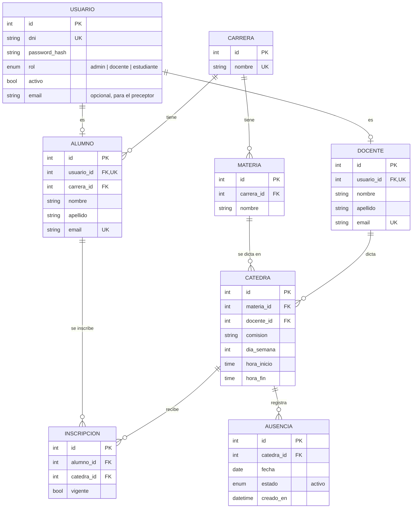

# Gestion Asist

API de **avisos de ausencia docente**: el docente avisa que no va a dar una clase concreta y los alumnos inscriptos en esa cátedra se enteran. Este repo es **solo la API**; la app Android (docentes y alumnos) y el frontend web (administrador / preceptor) son proyectos aparte.

Está construido con **FastAPI**, **SQLModel** (ORM) y **PostgreSQL**, y corre entero en **Docker**, así que funciona igual en cualquier máquina.

---

## Índice

1. [Estado del proyecto](#estado-del-proyecto)
2. [Tecnologías utilizadas](#tecnologías-utilizadas)
3. [Dependencias](#dependencias)
4. [Requisitos previos](#requisitos-previos)
5. [Instalación paso a paso](#instalación-paso-a-paso)
6. [Variables de entorno](#variables-de-entorno)
7. [Modelo de datos](#modelo-de-datos)
8. [API: endpoints disponibles](#api-endpoints-disponibles)
9. [Estructura de carpetas](#estructura-de-carpetas)
10. [Cómo fluye un request](#cómo-fluye-un-request)
11. [Agregar un recurso nuevo (guía)](#agregar-un-recurso-nuevo-guía)
12. [Migraciones de base de datos](#migraciones-de-base-de-datos)
13. [Tests](#tests)
14. [Comandos útiles](#comandos-útiles)
15. [Solución de problemas](#solución-de-problemas)

---

## Estado del proyecto

| HU     | Rol        | Qué                                                        | Estado |
|--------|------------|------------------------------------------------------------|--------|
| HU-01  | Todos      | Login con DNI y contraseña                                 | ✅ `/auth/login`, `/auth/me` |
| HU-02  | Docente    | Registrar aviso eligiendo una clase concreta de una lista  | ✅ `/docente/clases-disponibles`, `/docente/avisos` |
| HU-03  | Docente    | Ver el historial de sus avisos                             | ✅ `GET /docente/avisos` |
| ~~HU-04~~ | —       | Cancelar aviso: **descartada** (un aviso no se cancela ni se edita) | ❌ |
| HU-05  | Estudiante | Ver avisos de cátedras donde tiene inscripción vigente     | ⏳ |
| HU-06  | Estudiante / Preceptor | Notificación push + correo al registrarse un aviso | ⏳ |
| HU-07  | Estudiante | Ver sus inscripciones vigentes y sus avisos                | ⏳ |
| HU-08  | Admin      | Alta de docentes y estudiantes                             | ✅ `/docentes`, `/alumnos` |
| HU-09  | Admin      | Listar avisos con filtros                                  | ⏳ |
| HU-10  | Admin      | Asignar docentes a materias (cátedras)                     | ✅ `/catedras` |

Además: CRUD de administrador para carreras, materias e inscripciones (necesarios para cargar los datos).

-----------------------------|---------------------------------------------------------------------------------------|
| Modelos / tablas            | ✅ Todos creados: Carrera, Materia, Alumno, Docente, Cátedra, Inscripción, Ausencia    |
| Migración inicial           | ✅ `alembic/versions/cd7107349f41_tablas_iniciales.py`                                 |
| API de Carreras             | ✅ CRUD completo                                                                       |
| API de salud (`/health`)    | ✅                                                                                     |
| API del resto de recursos   | ⏳ Pendiente (seguir la [guía para agregar un recurso](#agregar-un-recurso-nuevo-guía)) |
| Páginas web (HTML)          | ⏳ Solo la página de inicio                                                            |

---

## Tecnologías utilizadas

| Herramienta        | Versión | Para qué se usa                                                               |
|--------------------|---------|-------------------------------------------------------------------------------|
| Python             | 3.12    | Lenguaje de la aplicación.                                                    |
| FastAPI            | 0.149   | Framework web: rutas, validación de datos y documentación automática (`/docs`). |
| SQLModel           | 0.0.48  | ORM: define las tablas como clases Python (une SQLAlchemy + Pydantic).        |
| PostgreSQL         | 17      | Base de datos relacional.                                                     |
| psycopg (v3)       | 3.3     | Driver que conecta Python con PostgreSQL.                                     |
| Alembic            | 1.20    | Migraciones: versiona los cambios en la estructura de la base.                |
| pydantic-settings  | 2.16    | Lee la configuración desde el archivo `.env`.                                 |
| Jinja2             | —       | Plantillas HTML para las páginas web (viene incluido en `fastapi[standard]`). |
| Uvicorn            | —       | Servidor que ejecuta la app (viene incluido en `fastapi[standard]`).          |
| pytest             | 9.1     | Tests automáticos.                                                            |
| Docker / Compose   | —       | Corre la app y PostgreSQL en contenedores, igual en cualquier máquina.        |

---

## Dependencias

Todas las dependencias de Python están en [requirements.txt](requirements.txt) con **versión fija**, para que todos instalen exactamente lo mismo:

```text
fastapi[standard]==0.149.0   # FastAPI + Uvicorn + Jinja2 + CLI "fastapi" + httpx (para tests)
sqlmodel==0.0.48             # ORM (trae SQLAlchemy y Pydantic)
psycopg[binary]==3.3.6       # Driver de PostgreSQL (versión precompilada, no requiere compilar nada)
alembic==1.20.0              # Migraciones
pydantic-settings==2.16.0    # Configuración desde .env
pytest==9.1.1                # Tests
pwdlib[argon2]==0.3.1        # Encriptado de contraseñas (Argon2)
pyjwt==2.15.1                # Tokens de acceso (JWT)
tzdata==2026.5               # Zonas horarias para zoneinfo (también en Windows)
```

No hace falta instalarlas a mano para correr la app: **Docker las instala solo** al construir la imagen. Solo las instalás en tu máquina (dentro de un entorno virtual) para que el editor autocomplete y para correr `alembic` y `pytest` desde la terminal (ver [paso 5](#paso-5-entorno-virtual-local-recomendado)).

**Para agregar una dependencia nueva:**

1. Con el `.venv` activo: `pip install <paquete>`
2. Ver qué versión se instaló: `pip show <paquete>`
3. Agregarla a `requirements.txt` con esa versión: `<paquete>==X.Y.Z`
4. Reconstruir la imagen: `docker compose up --build`

---

## Requisitos previos

Necesitás tener instalado:

| Programa            | Para qué                                  | Cómo verificar que está     |
|---------------------|-------------------------------------------|-----------------------------|
| **Git**             | Descargar el código                       | `git --version`             |
| **Docker**          | Correr la app y la base de datos          | `docker --version`          |
| **Docker Compose**  | Levantar los dos contenedores juntos      | `docker compose version`    |
| **Python 3.12**     | Entorno virtual local (opcional, recomendado) | `python3 --version`     |

### Linux (Ubuntu / Debian)

```bash
# Git y Python (con soporte para entornos virtuales)
sudo apt update
sudo apt install -y git python3 python3-venv python3-pip

# Docker y Compose
sudo apt install -y docker.io docker-compose-v2

# Usar Docker sin sudo (después cerrá sesión y volvé a entrar)
sudo usermod -aG docker $USER
```

> Si preferís la versión más reciente de Docker, seguí la [guía oficial de Docker Engine](https://docs.docker.com/engine/install/ubuntu/).

### Windows

En Windows se trabaja **dentro de WSL** (un Linux integrado en Windows):

1. Abrir PowerShell como administrador y ejecutar `wsl --install`. Reiniciar.
2. Instalar [Docker Desktop](https://www.docker.com/products/docker-desktop/) y, en *Settings → Resources → WSL Integration*, activar la integración con tu distribución (Ubuntu).
3. Abrir la terminal de **Ubuntu (WSL)** e instalar Git y Python con los comandos de la sección de Linux (sin la parte de Docker, que ya la da Docker Desktop).
4. Seguir todos los pasos de abajo **desde la terminal de WSL**.

> Clonar el proyecto dentro del sistema de archivos de WSL (por ejemplo `~/proyectos`), **no** en `/mnt/c/...`: es mucho más rápido y evita problemas de permisos.

### macOS

Instalar [Docker Desktop](https://www.docker.com/products/docker-desktop/) y, con [Homebrew](https://brew.sh/): `brew install git python@3.12`.

---

## Instalación paso a paso

Todos los comandos se ejecutan **parado en la carpeta raíz del proyecto** (donde están `app/`, `.env` y `docker-compose.yml`), salvo el primero.

### Paso 1: Clonar el repositorio

```bash
git clone https://github.com/Andres-M1/Gestion-asistencia.git
cd Gestion-asistencia
```

### Paso 2: Crear el archivo `.env`

El `.env` guarda la configuración (usuario y contraseña de la base, etc.). No se sube a git; se crea a partir de la plantilla:

```bash
cp .env.example .env
```

Para desarrollo local los valores de ejemplo sirven tal cual. Si querés, cambiá usuario, contraseña y nombre de la base (ver [Variables de entorno](#variables-de-entorno)).

> La primera vez que arranca, el contenedor de PostgreSQL **crea solo** ese usuario y esa base. No hace falta instalar PostgreSQL ni usar `psql`.

### Paso 3: Levantar todo

```bash
docker compose up --build
```

La primera vez tarda unos minutos (descarga imágenes e instala dependencias). Esto:

1. Construye la imagen de la app (Python + dependencias + código).
2. Arranca PostgreSQL y espera a que esté listo para recibir conexiones.
3. Aplica las migraciones (`alembic upgrade head`), que crean las tablas.
4. Levanta FastAPI en modo desarrollo, **con recarga automática**: si editás el código, la app se reinicia sola.

Sabés que está listo cuando en los logs aparece algo como:

```text
web-1  |       INFO   Application startup complete.
```

> Para dejarlo corriendo en segundo plano y recuperar la terminal: `docker compose up -d --build`.

### Paso 4: Verificar que funciona

Abrí en el navegador:

| URL                                        | Qué deberías ver                                    |
|--------------------------------------------|-----------------------------------------------------|
| http://localhost:8000                      | Página de inicio: "La aplicación está funcionando". |
| http://localhost:8000/docs                 | Documentación interactiva de la API (Swagger).      |
| http://localhost:8000/api/v1/health        | `{"status":"ok","database":"ok"}`                   |

Si `/health` responde `ok`, la app y la base de datos están conectadas. 🎉

Para detener: `Ctrl+C` (o `docker compose down` si lo levantaste con `-d`). Los datos **se conservan** entre reinicios.

### Paso 5: Entorno virtual local (recomendado)

La app ya corre en Docker, pero conviene tener las dependencias también en tu máquina para:

- que VS Code (u otro editor) autocomplete y marque errores;
- correr `alembic` (migraciones) y `pytest` (tests) desde tu terminal.

```bash
python3 -m venv .venv            # crea el entorno (solo la primera vez)
source .venv/bin/activate        # lo activa (Linux / macOS / WSL)
pip install -r requirements.txt  # instala las dependencias
```

> En Windows **sin** WSL (PowerShell) se activa con `.venv\Scripts\Activate.ps1`.

Cuando el entorno está activo, la terminal muestra `(.venv)` al principio. Hay que activarlo **cada vez que abrís una terminal nueva**. Para salir: `deactivate`.

En VS Code: `Ctrl+Shift+P` → *Python: Select Interpreter* → elegir el de `.venv`.

### Alternativa: app local + base en Docker

Si preferís correr FastAPI directamente en tu máquina (por ejemplo, para usar el debugger del editor), podés levantar **solo la base** en Docker:

```bash
docker compose up -d db          # solo PostgreSQL
source .venv/bin/activate
alembic upgrade head             # crea las tablas
fastapi dev app/main.py          # app en http://localhost:8000
```

No levantes al mismo tiempo el contenedor `web`, porque los dos usan el puerto 8000.

---

## Variables de entorno

Se definen en `.env` (plantilla: [.env.example](.env.example)) y las lee [app/core/config.py](app/core/config.py).

| Variable            | Ejemplo          | Descripción                                                              |
|---------------------|------------------|--------------------------------------------------------------------------|
| `APP_NAME`          | `"Gestion Asist"`| Nombre de la app (título de la página y de `/docs`).                     |
| `DEBUG`             | `true`           | Modo depuración. Con `true` además se imprimen las consultas SQL en los logs. Usar `false` en producción. |
| `POSTGRES_USER`     | `postgres`       | Usuario de la base. El contenedor lo crea la primera vez.                |
| `POSTGRES_PASSWORD` | `postgres`       | Contraseña de ese usuario.                                               |
| `POSTGRES_DB`       | `gestion_asist`  | Nombre de la base de datos.                                              |
| `POSTGRES_HOST`     | `localhost`      | Dónde está la base **vista desde tu máquina**.                           |
| `POSTGRES_PORT`     | `5433`           | Puerto de la base **visto desde tu máquina**.                            |

### ¿Por qué `localhost:5433` y no `5432`?

Hay **una sola base de datos**: la del contenedor `db`. Pero se llega a ella por dos caminos distintos:

| Desde dónde                                        | Cómo se llega a la base               |
|----------------------------------------------------|---------------------------------------|
| Contenedor `web` (la app dentro de Docker)         | `db:5432` (red interna de Docker)     |
| Tu máquina (`.venv`, `alembic`, DBeaver, `psql`)   | `localhost:5433`                      |

- Se usa **5433** hacia afuera para no chocar con un PostgreSQL que puedas tener instalado en tu máquina (que normalmente usa el 5432).
- [docker-compose.yml](docker-compose.yml) **pisa** `POSTGRES_HOST` y `POSTGRES_PORT` para el contenedor `web` (los cambia a `db` y `5432`), así que en el `.env` siempre quedan `localhost` y `5433`.

### Conectarse con un cliente gráfico (DBeaver, pgAdmin, etc.)

| Campo      | Valor                                  |
|------------|----------------------------------------|
| Host       | `localhost`                            |
| Puerto     | `5433`                                 |
| Base       | el valor de `POSTGRES_DB`              |
| Usuario    | el valor de `POSTGRES_USER`            |
| Contraseña | el valor de `POSTGRES_PASSWORD`        |

> ⚠️ Si cambiás `POSTGRES_USER` o `POSTGRES_PASSWORD` **después** de la primera vez, el cambio no se aplica: la base ya fue creada y sus datos viven en un volumen de Docker. Para empezar de cero hay que borrarlo con `docker compose down -v` (**borra todos los datos**).

---

## Modelo de datos



| Tabla           | Qué representa                                                             | Reglas que impone la base                                       |
|-----------------|----------------------------------------------------------------------------|-----------------------------------------------------------------|
| **Usuario**     | Credenciales y rol de quien se loguea. El admin (preceptor) no tiene perfil. | DNI único. La contraseña se guarda encriptada (Argon2).         |
| **Carrera**     | Una carrera de la institución (ej. "Analista de Sistemas").                | El nombre no se puede repetir.                                  |
| **Materia**     | Una materia que pertenece a una carrera.                                   | —                                                               |
| **Alumno**      | Perfil de un estudiante, inscripto en una carrera.                         | Un perfil por usuario; email único.                             |
| **Docente**     | Perfil de un profesor.                                                     | Un perfil por usuario; email único.                             |
| **Cátedra**     | Una materia dictada por un docente en una comisión, un día y un horario.   | Comisión única por materia; `dia_semana` entre 1 (lunes) y 7 (domingo); `hora_fin` > `hora_inicio`. |
| **Inscripción** | Un alumno anotado en una cátedra.                                          | Un alumno no puede inscribirse dos veces en la misma cátedra.   |
| **Ausencia**    | Aviso de que el docente no dará una clase (cátedra + fecha).               | Un aviso por cátedra y fecha. No tiene motivo y no se cancela.  |

Una **clase** (ej. "Programación II · 1K1 · martes 03/11 · 18:00-20:00") no es una tabla: se calcula a partir de la cátedra (`dia_semana`, `hora_inicio`, `hora_fin`) y una fecha.

Los modelos están en [app/models/](app/models/), un archivo por tabla.

---

## API: endpoints disponibles

Todas las rutas de la API tienen el prefijo `/api/v1`. La forma más cómoda de probarlas es desde **http://localhost:8000/docs**: cada endpoint tiene un botón *Try it out*.

Salvo `/health` y `/auth/login`, **todas las rutas piden un token**. En `/docs`: botón **Authorize** → *username* = DNI, *password* = contraseña.

### Salud y autenticación

| Método | Ruta                  | Quién   | Qué hace                                     | Respuestas |
|--------|-----------------------|---------|----------------------------------------------|------------|
| GET    | `/api/v1/health`      | Todos   | Verifica que la API y la base respondan.     | `200` |
| POST   | `/api/v1/auth/login`  | Todos   | Recibe `{dni, password}` y devuelve el token. | `200` · `401` DNI o contraseña incorrectos |
| GET    | `/api/v1/auth/me`     | Logueado | Datos del usuario, su rol y su perfil.       | `200` · `401` |

### Docente (HU-02, HU-03)

| Método | Ruta                                   | Qué hace | Respuestas |
|--------|----------------------------------------|----------|------------|
| GET    | `/api/v1/docente/clases-disponibles`   | Próximas clases del docente sobre las que puede avisar. | `200` · `403` no es docente |
| POST   | `/api/v1/docente/avisos`               | Registra un aviso con `{catedra_id, fecha}`. Queda en estado `activo`. Devuelve el `AvisoDetalle`. | `201` · `404` cátedra inexistente o ajena · `409` ya hay aviso · `422` no cumple las reglas |
| GET    | `/api/v1/docente/avisos`               | Historial de avisos del docente (pasados y futuros), por fecha descendente. Paginado con `?offset=&limit=`. | `200` · `403` no es docente |

Una clase aparece en la lista (y el `POST` la acepta) solo si:

- la cátedra es del docente logueado;
- la fecha cae en el día de cursada de la cátedra;
- faltan **al menos 1 hora** para su inicio;
- empieza dentro de los **próximos 7 días**;
- no tiene ya un aviso.

Cada aviso se devuelve como **`AvisoDetalle`** (lo reusan HU-05 y HU-09). No incluye `estado`: un aviso registrado siempre está activo.

```json
{
  "id": 12, "fecha": "2026-11-03",
  "materia": "Programación I", "comision": "1K1",
  "dia_semana": 2, "hora_inicio": "18:00:00", "hora_fin": "20:00:00",
  "docente": {"nombre": "Laura", "apellido": "Gómez"},
  "creado_en": "2026-10-28T14:05:00Z"
}
```

Todo se calcula en **hora de Argentina** (`America/Argentina/Buenos_Aires`), aunque el contenedor esté en UTC. El `POST` vuelve a validar todo en el servidor: no confía en que el cliente mandó una opción de la lista. La lógica está en [app/services/ausencias.py](app/services/ausencias.py).

### Administrador (HU-08, HU-10)

Todas piden rol `admin`.

| Recurso                  | Rutas                                         | Notas |
|--------------------------|-----------------------------------------------|-------|
| `/api/v1/carreras`       | `POST` · `GET` · `GET /{id}` · `PATCH /{id}` · `DELETE /{id}` | |
| `/api/v1/materias`       | ídem                                           | Filtro `?carrera_id=` |
| `/api/v1/docentes`       | `POST` · `GET` · `GET /{id}` · `PATCH /{id}`   | Crea usuario + perfil. Sin `DELETE`: se desactiva con `{"activo": false}` |
| `/api/v1/alumnos`        | ídem                                           | Filtro `?carrera_id=`. Sin `DELETE` |
| `/api/v1/catedras`       | `POST` · `GET` · `GET /{id}` · `PATCH /{id}` · `DELETE /{id}` | Asigna docente a materia. Filtros `?materia_id=`, `?docente_id=` |
| `/api/v1/inscripciones`  | ídem                                           | Filtros `?alumno_id=`, `?catedra_id=`, `?vigente=`. Baja con `{"vigente": false}` |

Los listados aceptan `?offset=0&limit=100` (`limit` máximo: 100). Errores comunes: `401` sin token · `403` rol incorrecto · `404` no existe · `409` dato repetido o borrado con registros asociados · `422` datos inválidos.

### Crear el primer administrador

Sin un admin nadie puede dar de alta usuarios. La contraseña se pide por teclado:

```bash
docker compose exec web python -m app.scripts.crear_admin --dni 12345678
```

### Cargar datos de prueba

Herramienta de desarrollo: carga un preceptor, 2 carreras, 4 materias, 2 docentes, 6 alumnos, 5 cátedras e inscripciones (una con `vigente=false`). Todos con contraseña `prueba123`; al terminar imprime la tabla de usuarios.

```bash
docker compose exec web python -m app.scripts.cargar_datos_prueba
```

Se puede correr varias veces: lo que ya existe (por DNI, nombre, materia + comisión, etc.) se saltea sin modificarlo. No crea avisos. Los datos quedan en la base de desarrollo; para borrarlos, empezar de cero con `docker compose down -v`.

### Probar HU-02 en `/docs`

1. Con el admin logueado (**Authorize**): crear una carrera, una materia, un docente (`POST /docentes`) y una cátedra de ese docente (`POST /catedras`) con un `dia_semana` de los próximos días.
2. **Logout** en Authorize y volver a loguearse con el DNI y la contraseña del docente.
3. `GET /docente/clases-disponibles` → copiar `catedra_id` y `fecha` de una opción.
4. `POST /docente/avisos` con esos datos → `201`. Repetirlo → `409`. Volver a listar: esa clase ya no aparece.
5. `GET /docente/avisos` (HU-03) → el aviso recién creado aparece primero si es el de fecha más lejana. Con los [datos de prueba](#cargar-datos-de-prueba), entrar como `22222222` o `22222223`.

---

## Estructura de carpetas

```
Gestion-asistencia/
├── .venv/                    # Entorno virtual de Python (no se sube a git)
├── .env                      # Variables de entorno reales (no se sube a git)
├── .env.example              # Plantilla de .env para otros desarrolladores
├── .gitignore                # Archivos que git debe ignorar
├── .dockerignore             # Archivos que no se copian a la imagen de Docker
├── requirements.txt          # Dependencias con versión fija
├── Dockerfile                # Receta de la imagen de la app (Python + dependencias + código)
├── docker-compose.yml        # Levanta los servicios "db" (PostgreSQL) y "web" (FastAPI)
├── alembic.ini               # Configuración de Alembic
├── alembic/                  # Migraciones de base de datos
│   ├── env.py                # Conecta Alembic con la config y los modelos de SQLModel
│   ├── script.py.mako        # Plantilla de cada archivo de migración
│   └── versions/             # Archivos de migración generados
├── app/                      # Código de la aplicación
│   ├── main.py               # Punto de entrada: crea la app FastAPI y registra rutas
│   ├── core/                 # Configuración central
│   │   ├── config.py         # Settings (lee .env) y arma la DATABASE_URL
│   │   ├── database.py       # Engine de la BD y función get_session()
│   │   └── security.py       # Contraseñas (Argon2) y tokens (JWT)
│   ├── models/               # Modelos ORM = tablas de la base de datos (uno por archivo)
│   │   └── __init__.py       # Importar aquí cada modelo para que Alembic lo detecte
│   ├── schemas/              # Esquemas de entrada/salida de la API (qué recibe y devuelve)
│   ├── crud/                 # Acceso a datos: base.py (CRUD genérico) y usuario.py
│   ├── services/             # Reglas de negocio (auth, personas, ausencias)
│   ├── scripts/              # Comandos de consola (crear_admin.py)
│   ├── api/                  # Capa HTTP
│   │   ├── deps.py           # Dependencias comunes: sesión de BD, usuario actual, permisos por rol
│   │   ├── errores.py        # Traduce errores de la base a mensajes HTTP
│   │   └── v1/               # Versión 1 de la API (prefijo /api/v1)
│   │       ├── router.py     # Junta todos los routers de endpoints
│   │       └── endpoints/    # Un archivo por recurso (health.py, carreras.py, ...)
│   ├── templates/            # Plantillas HTML (Jinja2)
│   │   ├── base.html         # Layout común
│   │   └── index.html        # Página de inicio
│   └── static/               # Archivos estáticos servidos en /static
│       ├── css/
│       ├── js/
│       └── img/
└── tests/                    # Tests con pytest (conftest.py = fixtures compartidas)
```

### ¿Por qué el Dockerfile dice `fastapi run` y el compose `fastapi dev`?

- El [Dockerfile](Dockerfile) define el comando **de producción** (`fastapi run`): sin recarga automática, más eficiente.
- [docker-compose.yml](docker-compose.yml) lo reemplaza para desarrollo: primero aplica migraciones y después usa `fastapi dev`, que reinicia la app cada vez que guardás un archivo. Esto funciona porque el compose monta la carpeta del proyecto dentro del contenedor (`.:/code`), así que el contenedor ve tus cambios al instante.

---

## Cómo fluye un request

```
Navegador / cliente
   → api/v1/endpoints/*.py    (recibe el request, valida con schemas/)
   → services/*.py            (aplica reglas de negocio, si las hay)
   → crud/*.py                (consulta/modifica la BD usando models/)
   → PostgreSQL
```

Separar en capas hace que cada archivo tenga una sola responsabilidad: los endpoints no escriben SQL y los CRUD no saben nada de HTTP. El recurso **Carrera** es el ejemplo completo a seguir: [models](app/models/carrera.py) → [schemas](app/schemas/carrera.py) → [crud genérico](app/crud/base.py) → [endpoints](app/api/v1/endpoints/carreras.py). Para un caso con reglas de negocio, ver HU-02: [endpoints](app/api/v1/endpoints/docente.py) → [services](app/services/ausencias.py).

---

## Agregar un recurso nuevo (guía)

Ejemplo: agregar una tabla `Aula` con su API. Para los modelos que **ya existen** (Materia, Docente, etc.) salteá los pasos 1, 2 y 7 y empezá directo por los schemas.

1. **Modelo**: `app/models/aula.py`

   ```python
   from sqlmodel import Field, SQLModel

   class Aula(SQLModel, table=True):
       id: int | None = Field(default=None, primary_key=True)
       nombre: str = Field(unique=True)
       capacidad: int
   ```

2. **Registrarlo** en `app/models/__init__.py` (si no, Alembic no lo ve):

   ```python
   from app.models.aula import Aula  # noqa: F401
   ```

3. **Schemas**: `app/schemas/aula.py` (lo que entra y sale por la API)

   ```python
   from sqlmodel import SQLModel

   class AulaCreate(SQLModel):
       nombre: str
       capacidad: int

   class AulaUpdate(SQLModel):
       nombre: str | None = None
       capacidad: int | None = None

   class AulaRead(SQLModel):
       id: int
       nombre: str
       capacidad: int
   ```

4. **CRUD**: para operaciones simples alcanza con el genérico [app/crud/base.py](app/crud/base.py) (`crud.crear(session, Aula.model_validate(data))`, `crud.listar(session, Aula)`, etc.), como hace [carreras.py](app/api/v1/endpoints/carreras.py). Si necesitás consultas propias, `app/crud/aula.py`:

   ```python
   from sqlmodel import Session, select

   from app.models.aula import Aula
   from app.schemas.aula import AulaCreate

   def crear(session: Session, data: AulaCreate) -> Aula:
       aula = Aula.model_validate(data)
       session.add(aula)
       session.commit()
       session.refresh(aula)
       return aula

   def listar(session: Session) -> list[Aula]:
       return list(session.exec(select(Aula).order_by(Aula.id)))
   ```

5. **Endpoints**: `app/api/v1/endpoints/aulas.py`

   ```python
   from fastapi import APIRouter, status

   from app.api.deps import SessionDep
   from app.crud import aula as crud
   from app.schemas.aula import AulaCreate, AulaRead

   router = APIRouter(prefix="/aulas")

   @router.post("/", response_model=AulaRead, status_code=status.HTTP_201_CREATED)
   def crear(data: AulaCreate, session: SessionDep):
       return crud.crear(session, data)

   @router.get("/", response_model=list[AulaRead])
   def listar(session: SessionDep):
       return crud.listar(session)
   ```

   Para obtener, modificar y borrar, y para manejar errores 404/409, copiá el patrón de [carreras.py](app/api/v1/endpoints/carreras.py).

6. **Registrar el router** en `app/api/v1/router.py`:

   ```python
   from app.api.v1.endpoints import aulas, carreras, health

   api_router.include_router(aulas.router, tags=["aulas"])
   ```

7. **Crear y aplicar la migración** (con el `.venv` activo y la base levantada):

   ```bash
   alembic revision --autogenerate -m "crear tabla aula"
   alembic upgrade head
   ```

8. **Probar** en http://localhost:8000/docs: la sección `aulas` aparece sola.

---

## Migraciones de base de datos

Una **migración** es un archivo Python que describe un cambio en la estructura de la base (crear una tabla, agregar una columna, etc.). Se guardan en [alembic/versions/](alembic/versions/) y se suben a git, así todos tienen la misma estructura.

**Flujo de trabajo** cada vez que cambiás un modelo:

1. Modificar el modelo en `app/models/`.
2. Generar la migración: `alembic revision --autogenerate -m "descripción del cambio"`.
3. **Revisar** el archivo generado en `alembic/versions/`: Alembic adivina los cambios y a veces se equivoca (por ejemplo, un renombre lo interpreta como borrar una columna y crear otra).
4. Aplicarla: `alembic upgrade head`.
5. Subir a git el modelo **y** la migración juntos.

Cuando bajás cambios de otra persona (`git pull`) que incluyen migraciones nuevas, alcanza con reiniciar el contenedor (`docker compose restart web`), que aplica las migraciones al arrancar, o con correr `alembic upgrade head`.

> 💡 Generá las migraciones **desde tu máquina** (con el `.venv`), no con `docker compose exec web alembic revision ...`: dentro del contenedor los archivos se crean con dueño `root` y después no los podés editar sin `sudo`.

---

## Tests

Los tests están en [tests/](tests/) y se escriben con pytest. Para correrlos:

```bash
# Desde tu máquina (con el .venv activo)
pytest

# O dentro del contenedor
docker compose exec web pytest
```

Opciones útiles: `pytest -v` (muestra cada test), `pytest tests/test_main.py` (un solo archivo), `pytest -k nombre` (los tests que contengan "nombre").

Los tests corren contra la base de Docker (`localhost:5433`), así que necesitan el contenedor `db` levantado, pero **no dejan datos**: cada test se ejecuta dentro de una transacción que se revierte al terminar. Con `join_transaction_mode="create_savepoint"`, los `commit()` de los services solo cierran un savepoint.

Fixtures de [tests/conftest.py](tests/conftest.py):

| Fixture   | Qué da |
|-----------|--------|
| `session` | Sesión de base dentro de la transacción que se revierte. |
| `client`  | `TestClient` que usa esa misma sesión. |
| `datos`   | Carrera, materias, dos docentes con cátedras, un alumno, un admin y un docente sin perfil. |
| `auth(usuario)` | Encabezado `Authorization` para ese usuario (función, no fixture). |

Para reglas que dependen de la hora, los tests **fijan la hora actual** reemplazando `app.services.ausencias.ahora` (ver `fijar_ahora` en [tests/test_hu02_avisos.py](tests/test_hu02_avisos.py)).

```python
from tests.conftest import auth

def test_me(client, datos):
    r = client.get("/api/v1/auth/me", headers=auth(datos["u_doc_a"]))
    assert r.json()["rol"] == "docente"
```

---

## Comandos útiles

### Docker

| Comando                                              | Qué hace                                          |
|------------------------------------------------------|---------------------------------------------------|
| `docker compose up --build`                          | Construye y levanta base + app (logs en vivo)     |
| `docker compose up -d`                               | Levanta en segundo plano                          |
| `docker compose up -d db`                            | Levanta solo la base de datos                     |
| `docker compose logs -f web`                         | Muestra los logs de la app en vivo                |
| `docker compose ps`                                  | Lista los contenedores y su estado                |
| `docker compose restart web`                         | Reinicia la app (vuelve a aplicar migraciones)    |
| `docker compose down`                                | Detiene los contenedores (los datos se conservan) |
| `docker compose down -v`                             | Detiene y **borra la base de datos**              |
| `docker compose exec db sh -c 'psql -U "$POSTGRES_USER" -d "$POSTGRES_DB"'` | Abre `psql` dentro de la base |
| `docker compose exec web alembic upgrade head`       | Aplica migraciones dentro del contenedor          |
| `docker compose exec web pytest`                     | Corre los tests dentro del contenedor             |

Dentro de `psql`: `\dt` lista las tablas, `\d carrera` muestra una tabla, `\q` sale.

### Python / Alembic (con el `.venv` activo)

| Comando                                         | Qué hace                                     |
|-------------------------------------------------|----------------------------------------------|
| `source .venv/bin/activate`                     | Activa el entorno virtual                    |
| `deactivate`                                    | Sale del entorno virtual                     |
| `pip install -r requirements.txt`               | Instala / actualiza las dependencias         |
| `fastapi dev app/main.py`                       | Corre la app localmente (sin Docker)         |
| `alembic revision --autogenerate -m "mensaje"`  | Genera una migración a partir de los modelos |
| `alembic upgrade head`                          | Aplica todas las migraciones pendientes      |
| `alembic downgrade -1`                          | Revierte la última migración                 |
| `alembic current`                               | Muestra en qué migración está la base        |
| `alembic history`                               | Muestra el historial de migraciones          |
| `pytest`                                        | Ejecuta los tests                            |

---

## Solución de problemas

<details>
<summary><b><code>permission denied while trying to connect to the Docker daemon socket</code></b></summary>

Tu usuario no está en el grupo `docker`. Ejecutá:

```bash
sudo usermod -aG docker $USER
```

Después **cerrá sesión y volvé a entrar** (o ejecutá `newgrp docker` en esa terminal).
</details>

<details>
<summary><b><code>Bind for 0.0.0.0:8000 failed: port is already allocated</code> (o 5433)</b></summary>

Otro programa ya usa ese puerto (muchas veces, otra app FastAPI corriendo o un contenedor viejo). Opciones:

- Ver qué lo usa: `sudo lsof -i :8000` y cerrarlo.
- Ver si hay contenedores viejos: `docker ps` y detenerlos con `docker stop <id>`.
- O cambiar el puerto de tu lado en [docker-compose.yml](docker-compose.yml): por ejemplo `"8001:8000"` y entrar por http://localhost:8001. Si cambiás el de la base (`"5434:5432"`), actualizá también `POSTGRES_PORT` en el `.env`.
</details>

<details>
<summary><b><code>password authentication failed for user ...</code></b></summary>

Cambiaste usuario o contraseña en el `.env` después de que la base ya se había creado. PostgreSQL solo los toma la primera vez. Para recrear la base con los valores nuevos (**se borran todos los datos**):

```bash
docker compose down -v
docker compose up --build
```
</details>

<details>
<summary><b><code>connection refused</code> al correr <code>alembic</code> o <code>pytest</code> desde tu máquina</b></summary>

La base no está levantada, o el `.env` no apunta a `localhost:5433`.

- Levantá la base: `docker compose up -d db` y verificá con `docker compose ps` que diga `healthy`.
- Revisá que en el `.env` estén `POSTGRES_HOST=localhost` y `POSTGRES_PORT=5433`.
- Ejecutá los comandos **desde la carpeta raíz del proyecto** (ahí es donde se busca el `.env`).
</details>

<details>
<summary><b><code>ModuleNotFoundError: No module named 'app'</code> (o <code>'fastapi'</code>, <code>'sqlmodel'</code>...)</b></summary>

- No activaste el entorno virtual: `source .venv/bin/activate`.
- No estás en la carpeta raíz del proyecto.
- No instalaste las dependencias: `pip install -r requirements.txt`.
</details>

<details>
<summary><b><code>alembic revision --autogenerate</code> genera una migración vacía</b></summary>

Alembic no ve el modelo nuevo. Verificá que lo importaste en [app/models/__init__.py](app/models/__init__.py) y que la clase tiene `table=True`.
</details>

<details>
<summary><b>No puedo editar archivos de migración: <code>Permission denied</code></b></summary>

Se generaron dentro del contenedor y quedaron con dueño `root`. Recuperá la propiedad:

```bash
sudo chown -R $USER:$USER alembic/versions
```

Y de ahora en más generá las migraciones desde tu máquina con el `.venv`.
</details>

<details>
<summary><b><code>python3 -m venv .venv</code> falla con <code>ensurepip is not available</code></b></summary>

En Ubuntu/Debian falta el paquete de entornos virtuales:

```bash
sudo apt install python3-venv
```
</details>

<details>
<summary><b>Cambié el código y no se refleja</b></summary>

- Si cambiaste código Python: la app se recarga sola; mirá los logs (`docker compose logs -f web`) por si hay un error de sintaxis.
- Si cambiaste `requirements.txt` o el `Dockerfile`: hay que reconstruir con `docker compose up --build`.
- Si cambiaste el `.env`: reiniciá con `docker compose down && docker compose up`.
- Si cambiaste un modelo: falta crear y aplicar la migración (ver [Migraciones](#migraciones-de-base-de-datos)).
</details>

<details>
<summary><b>Quiero empezar de cero con la base vacía</b></summary>

```bash
docker compose down -v      # borra la base
docker compose up --build   # la recrea y aplica las migraciones
```
</details>
