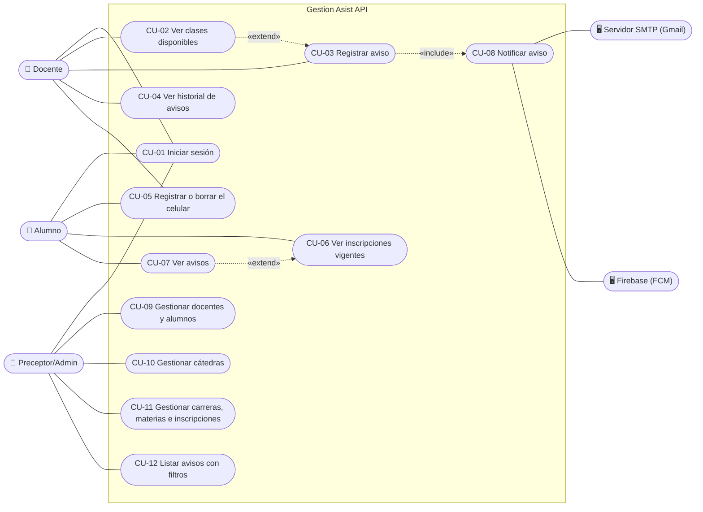

# Casos de uso

Casos de uso de la API de **Gestion Asist**, por actor. Las rutas empiezan con `/api/v1`. Los mensajes de error que aparecen acá son los que devuelve la API, en el campo `detail`.

## Índice

- [Actores](#actores)
- [Diagrama](#diagrama)
- [Errores comunes a todos los casos](#errores-comunes-a-todos-los-casos)
- Docente: [CU-01](#cu-01-iniciar-sesión) · [CU-02](#cu-02-ver-clases-disponibles) · [CU-03](#cu-03-registrar-aviso) · [CU-04](#cu-04-ver-historial-de-avisos) · [CU-05](#cu-05-registrar-o-borrar-el-celular-token-fcm)
- Alumno: [CU-06](#cu-06-ver-inscripciones-vigentes) · [CU-07](#cu-07-ver-avisos)
- Sistema: [CU-08](#cu-08-notificar-aviso)
- Preceptor/Admin: [CU-09](#cu-09-gestionar-docentes-y-alumnos) · [CU-10](#cu-10-gestionar-cátedras) · [CU-11](#cu-11-gestionar-carreras-materias-e-inscripciones) · [CU-12](#cu-12-listar-avisos-con-filtros)

## Actores

| Actor | Tipo | Cliente | Rol en la API |
|-------|------|---------|---------------|
| **Docente** | Principal | App Android | `docente` |
| **Alumno** | Principal | App Android | `estudiante` |
| **Preceptor/Admin** | Principal | Frontend web | `admin` |
| **Servidor SMTP (Gmail)** | Externo | — | Recibe los correos que envía la API (`smtplib`). Puede ser cualquier servidor SMTP con STARTTLS configurado en `.env`; `.env.example` sugiere Gmail. |
| **Firebase (FCM)** | Externo | — | Recibe los push que envía la API (`firebase-admin`) y los entrega a la app Android. |

## Diagrama

Notas sobre el diagrama:

- **CU-03 incluye CU-08:** todo aviso registrado dispara las notificaciones.
- **CU-02 → CU-03:** la app arma la lista con CU-02 y el docente elige una opción. CU-03 no depende de CU-02, porque el servidor vuelve a validar todo.
- **CU-07 → CU-06:** desde cada inscripción, el alumno puede ver los avisos de esa cátedra (`?catedra_id=`).
- Alumnos y preceptores son destinatarios de CU-08, pero no lo inician.

## Errores comunes a todos los casos

Valen para todos los casos que requieren sesión (todos menos CU-01) y no se repiten en cada ficha.

| Código | Cuándo | `detail` |
|--------|--------|----------|
| 401 | Request sin `Authorization: Bearer` | `"Not authenticated"` |
| 401 | Token inválido, vencido, o de un usuario inexistente o desactivado | `"Token inválido o expirado"` |
| 403 | El rol del usuario no es el del caso de uso | `"No tenés permiso para esta acción"` |
| 422 | Body o parámetros con tipo o formato inválido (validación de FastAPI/Pydantic) | Lista de errores por campo |

---

## CU-01: Iniciar sesión

| | |
|---|---|
| **Actor** | Docente, Alumno o Preceptor/Admin |
| **HU** | HU-01 |
| **Endpoints** | `POST /auth/login`, `GET /auth/me` |
| **Precondición** | El usuario existe y está activo. Docentes y alumnos los da de alta el admin (CU-09); los admins se crean con `app/scripts/crear_admin.py`. |

**Flujo principal**

1. El actor ingresa DNI y contraseña en su cliente.
2. El cliente envía `POST /auth/login` con `{dni, password}`.
3. La API busca el usuario por DNI, verifica la contraseña (Argon2) y que esté activo.
4. La API devuelve `200` con un JWT (`access_token`) que lleva el id del usuario (`sub`), su `rol` y el vencimiento (`exp`).
5. El cliente pide `GET /auth/me` con el token y recibe `id`, `dni`, `rol` y `perfil`.
6. El cliente muestra las funciones del rol. Si es la app Android, sigue con CU-05.

**Flujos alternativos**

- **3a.** DNI inexistente, contraseña incorrecta o usuario desactivado → `401` `"DNI o contraseña incorrectos"`, con el mismo mensaje y tiempo de respuesta similar en los tres casos.
- **2a.** Falta `dni` o `password` en el body → `422`.
- **5a.** El usuario es admin → `perfil: null`.

**Postcondición:** el cliente tiene un token válido por `ACCESS_TOKEN_EXPIRE_MINUTES` minutos (480 por defecto). No se guarda nada en la base.

---

## CU-02: Ver clases disponibles

| | |
|---|---|
| **Actor** | Docente |
| **HU** | HU-02 |
| **Endpoint** | `GET /docente/clases-disponibles` |
| **Precondición** | Sesión iniciada con rol `docente` y perfil de docente. |

**Flujo principal**

1. El docente abre la pantalla "Avisar ausencia".
2. La app pide `GET /docente/clases-disponibles`.
3. La API toma la hora actual de Argentina y recorre los días entre ahora + 1 hora y ahora + 7 días.
4. Para cada cátedra del docente cuyo `dia_semana` coincide con el día, arma la clase si empieza dentro de ese rango y no tiene aviso.
5. La API devuelve `200` con las clases ordenadas por fecha y hora de inicio.

**Flujos alternativos**

- **3a.** El docente no tiene cátedras, o ninguna clase cumple las reglas → `200` con `[]`.
- **2a.** El usuario tiene rol `docente` pero no tiene perfil de docente → `403` `"El usuario no tiene perfil de docente"`.

**Postcondición:** ninguna (solo lectura).

---

## CU-03: Registrar aviso

| | |
|---|---|
| **Actor** | Docente |
| **HU** | HU-02 (y dispara HU-06) |
| **Endpoint** | `POST /docente/avisos` |
| **Precondición** | Sesión iniciada con rol `docente` y perfil de docente. |

**Flujo principal**

1. El docente elige una clase de la lista (CU-02) y confirma.
2. La app envía `POST /docente/avisos` con `{catedra_id, fecha}`.
3. La API valida:
   1. que la cátedra exista y sea del docente;
   2. que la fecha caiga en el `dia_semana` de la cátedra;
   3. que falte al menos 1 hora para `fecha + hora_inicio` (hora de Argentina);
   4. que la clase empiece dentro de los próximos 7 días.
4. La API guarda el aviso (`docente_id` = el docente logueado, `estado = activo`, `creado_en` = ahora en UTC).
5. Se ejecuta **CU-08 Notificar aviso** (include): se arman los destinatarios y se programa el envío en segundo plano.
6. La API devuelve `201` con el detalle del aviso.

**Flujos alternativos**

- **3.1a.** La cátedra no existe o es de otro docente → `404` `"Cátedra no encontrada"`.
- **3.2a.** La fecha no es día de cursada → `422` `"La fecha no corresponde al día de cursada de la cátedra"`.
- **3.3a.** Falta menos de 1 hora, o la clase ya pasó → `422` `"Solo se puede avisar hasta 1 hora antes del inicio de la clase"`.
- **3.4a.** La clase está a más de 7 días → `422` `"Solo se puede avisar sobre clases de los próximos 7 días"`.
- **4a.** Ya existe un aviso para esa cátedra y fecha (`uq_ausencia_catedra_fecha`) → `409` `"Ya hay un aviso para esa cátedra en esa fecha"`. No se guarda nada.
- **2a.** El usuario no tiene perfil de docente → `403` `"El usuario no tiene perfil de docente"`.
- **5a.** Falla el armado de los destinatarios → se registra en el log y el aviso queda creado igual (`201`).

**Postcondición:** existe una fila en `ausencia` para esa cátedra y fecha, a nombre del docente que la dio, y quedó programado el envío de notificaciones. El aviso no se puede cancelar ni editar.

---

## CU-04: Ver historial de avisos

| | |
|---|---|
| **Actor** | Docente |
| **HU** | HU-03 |
| **Endpoint** | `GET /docente/avisos?offset=&limit=` |
| **Precondición** | Sesión iniciada con rol `docente` y perfil de docente. |

**Flujo principal**

1. El docente abre "Mis avisos".
2. La app pide `GET /docente/avisos`.
3. La API devuelve `200` con los avisos que dio el docente (`ausencia.docente_id`), pasados y futuros, del más nuevo al más viejo. Si una cátedra se reasignó, los avisos anteriores siguen siendo de quien los dio.

**Flujos alternativos**

- **3a.** No tiene avisos → `200` con `[]`.
- **2a.** `limit` mayor a 100 → `422`.
- **2b.** Sin perfil de docente → `403` `"El usuario no tiene perfil de docente"`.

**Postcondición:** ninguna (solo lectura).

---

## CU-05: Registrar o borrar el celular (token FCM)

| | |
|---|---|
| **Actor** | Docente o Alumno |
| **HU** | HU-06 |
| **Endpoints** | `PUT /auth/me/fcm-token`, `DELETE /auth/me/fcm-token` |
| **Precondición** | Sesión iniciada con rol `docente` o `estudiante`. La app obtuvo un token de Firebase. |

**Flujo principal (registrar)**

1. Después del login, o cuando Firebase entrega un token nuevo (`onNewToken`), la app envía `PUT /auth/me/fcm-token` con `{"token": "..."}`.
2. Si otro usuario tenía ese mismo token (mismo celular), la API se lo quita (`fcm_token = null`).
3. La API guarda el token en el usuario y devuelve `204`.

**Flujo principal (borrar)**

1. Al cerrar sesión, la app envía `DELETE /auth/me/fcm-token`.
2. La API pone `fcm_token = null` y devuelve `204`.

**Flujos alternativos**

- **1a.** Token vacío o de más de 4096 caracteres → `422`.
- **1b.** El usuario es admin → `403` `"No tenés permiso para esta acción"`.

**Postcondición:** el usuario tiene como mucho un token, y ese token no está en ningún otro usuario. Solo los alumnos reciben push (CU-08).

---

## CU-06: Ver inscripciones vigentes

| | |
|---|---|
| **Actor** | Alumno |
| **HU** | HU-07 |
| **Endpoint** | `GET /alumno/inscripciones` |
| **Precondición** | Sesión iniciada con rol `estudiante` y perfil de alumno. |

**Flujo principal**

1. El alumno abre "Mis materias".
2. La app pide `GET /alumno/inscripciones`.
3. La API devuelve `200` con las inscripciones vigentes (materia, comisión, día, horario y docente), en el orden de la semana.
4. El alumno elige una y ve sus avisos (CU-07 con `catedra_id`).

**Flujos alternativos**

- **3a.** No tiene inscripciones vigentes → `200` con `[]`.
- **2a.** Sin perfil de alumno → `403` `"El usuario no tiene perfil de alumno"`.

**Postcondición:** ninguna (solo lectura).

---

## CU-07: Ver avisos

| | |
|---|---|
| **Actor** | Alumno |
| **HU** | HU-05, HU-07 |
| **Endpoint** | `GET /alumno/avisos?catedra_id=&offset=&limit=` |
| **Precondición** | Sesión iniciada con rol `estudiante` y perfil de alumno. |

**Flujo principal**

1. La app pide `GET /alumno/avisos`, opcionalmente con `catedra_id`.
2. La API devuelve `200` con los avisos de hoy en adelante (hora de Argentina) de las cátedras donde el alumno tiene inscripción vigente, del más próximo al más lejano.

**Flujos alternativos**

- **1a.** Con `catedra_id` de una cátedra donde no tiene inscripción vigente, o que no existe → `404` `"No tenés una inscripción vigente en esa cátedra"`.
- **2a.** No hay avisos → `200` con `[]`.
- **1b.** `limit` mayor a 100 → `422`.
- **1c.** Sin perfil de alumno → `403` `"El usuario no tiene perfil de alumno"`.

**Postcondición:** ninguna (solo lectura).

---

## CU-08: Notificar aviso

| | |
|---|---|
| **Actor** | Sistema (lo dispara CU-03). Actores externos: Servidor SMTP (Gmail) y Firebase (FCM). Destinatarios: Alumno y Preceptor/Admin. |
| **HU** | HU-06 |
| **Código** | `app/services/notificaciones.py`, `app/core/correo.py`, `app/core/push.py` |
| **Precondición** | Se acaba de guardar un aviso (CU-03, paso 4). |

**Flujo principal**

1. Durante el request, la API arma los destinatarios:
   - **emails**: alumnos activos con inscripción vigente en la cátedra, más los admins activos con email (sin repetidos);
   - **tokens**: el `fcm_token` de esos alumnos, si lo tienen (sin repetidos).
2. La API arma el asunto y el texto del correo, y el título y el cuerpo del push.
3. La API agrega **una** tarea a `BackgroundTasks` y responde `201` (CU-03).
4. Después de responder, la tarea:
   1. abre una conexión con el **Servidor SMTP** (STARTTLS, login si hay `SMTP_USER`) y envía un mensaje por destinatario;
   2. envía el push a **Firebase** en tandas de hasta 500 tokens;
   3. si Firebase rechazó tokens por `UNREGISTERED` o `SENDER_ID_MISMATCH`, los pone en `null` en la base.

**Flujos alternativos**

- **1a.** No hay destinatarios → no se envía nada.
- **4.1a.** SMTP no configurado (`SMTP_HOST`, o `SMTP_USER`/`SMTP_FROM`) → warning en el log; no se envían correos y el push sigue.
- **4.1b.** Falla un correo → se registra y se sigue con el siguiente.
- **4.1c.** Falla la conexión SMTP → se registra y se sigue con el push.
- **4.2a.** `FIREBASE_CREDENTIALS` vacío, o el archivo no sirve para iniciar Firebase → se registra y no se envían push.
- **4.2b.** Falla una tanda → se registra y se sigue con la siguiente.
- **4.2c.** Un token falla por otro motivo (ej. `INVALID_ARGUMENT`) → warning en el log; el token **no** se borra.

**Postcondición:** el aviso existe siempre, haya fallado o no algún envío. No queda registro de los envíos en la base, solo en el log.

---

## CU-09: Gestionar docentes y alumnos

| | |
|---|---|
| **Actor** | Preceptor/Admin |
| **HU** | HU-08 |
| **Endpoints** | `POST/GET /docentes/`, `GET/PATCH /docentes/{id}`, `POST/GET /alumnos/`, `GET/PATCH /alumnos/{id}` |
| **Precondición** | Sesión iniciada con rol `admin`. Para un alumno, la carrera ya existe. |

**Flujo principal (alta)**

1. El admin completa DNI, contraseña, nombre, apellido, email y, para un alumno, la carrera.
2. La web envía `POST /docentes/` o `POST /alumnos/`.
3. La API crea en una transacción el `Usuario` (rol `docente` o `estudiante`, contraseña hasheada con Argon2) y el perfil.
4. La API devuelve `201` con `id` (del perfil), `dni`, nombre, apellido, email, `activo` y, si es alumno, `carrera_id`.

**Flujo principal (edición o baja)**

1. El admin envía `PATCH /docentes/{id}` o `PATCH /alumnos/{id}` con los campos a cambiar: nombre, apellido, email, `password`, `activo` y, si es alumno, `carrera_id`.
2. La API devuelve `200` con los datos actualizados.

**Flujos alternativos**

- **1a.** DNI que no son 6 a 10 dígitos, contraseña de menos de 8 caracteres, email inválido o nombre vacío → `422`.
- **3a.** DNI ya registrado → `409` `"Ya existe un usuario con ese DNI"`.
- **3b.** Email repetido → `409` `"Ya existe un docente con ese email"` o `"Ya existe un alumno con ese email"`.
- **3c.** `carrera_id` inexistente → `422` `"La carrera indicada no existe"`.
- **E1.** `id` inexistente en `GET`/`PATCH` → `404` `"Docente no encontrado"` o `"Alumno no encontrado"`.

**Postcondición:** el usuario puede loguearse (CU-01) si está activo. Con `activo: false` no puede loguearse, sus tokens dejan de servir y no recibe notificaciones. No hay borrado.

---

## CU-10: Gestionar cátedras

| | |
|---|---|
| **Actor** | Preceptor/Admin |
| **HU** | HU-10 |
| **Endpoints** | `POST/GET /catedras/`, `GET/PATCH/DELETE /catedras/{id}` |
| **Precondición** | Sesión iniciada con rol `admin`. Existen la materia y el docente. |

**Flujo principal**

1. El admin elige materia, docente, comisión, día y horario.
2. La web envía `POST /catedras/`.
3. La API valida y guarda la cátedra, y devuelve `201`.
4. Para reasignar la cátedra a otro docente, o cambiar comisión u horario, la web envía `PATCH /catedras/{id}`.

**Flujos alternativos**

- **1a.** `dia_semana` fuera de 1 a 7, `hora_fin` no posterior a `hora_inicio` en el alta, o comisión vacía → `422`.
- **4a.** En `PATCH`, `hora_fin` no posterior a `hora_inicio` → lo rechaza la base (`ck_catedra_horario`) → `422` `"hora_fin debe ser posterior a hora_inicio"`.
- **3a.** Materia o docente inexistentes → `422` `"La materia indicada no existe"` o `"El docente indicado no existe"`.
- **3b.** La materia ya tiene esa comisión → `409` `"Esa materia ya tiene una cátedra con esa comisión"`.
- **E1.** `DELETE` de una cátedra con inscripciones o avisos → `409` `"No se puede borrar: tiene registros asociados"`.
- **E2.** `id` inexistente → `404` `"Cátedra no encontrada"`.

**Postcondición:** la cátedra aparece en las clases disponibles de su docente (CU-02) y se le pueden cargar inscripciones (CU-11). Si se reasignó, los avisos anteriores siguen a nombre del docente que los dio.

---

## CU-11: Gestionar carreras, materias e inscripciones

| | |
|---|---|
| **Actor** | Preceptor/Admin |
| **HU** | Ninguna propia: son los datos que necesitan HU-05, HU-07, HU-08 y HU-10. |
| **Endpoints** | `/carreras/`, `/materias/` y `/inscripciones/`, cada uno con `POST`, `GET`, `GET /{id}`, `PATCH /{id}` y `DELETE /{id}` |
| **Precondición** | Sesión iniciada con rol `admin`. |

**Flujo principal**

1. El admin crea una carrera (`nombre`), materias de esa carrera (`carrera_id`, `nombre`) e inscripciones (`alumno_id`, `catedra_id`).
2. La API devuelve `201`. Las inscripciones se crean con `vigente = true`.
3. Para dar de baja una inscripción sin perder el registro, la web envía `PATCH /inscripciones/{id}` con `{"vigente": false}`.

**Flujos alternativos**

- **1a.** Nombre de carrera repetido → `409` `"Ya existe una carrera con ese nombre"`.
- **1b.** Carrera, alumno o cátedra inexistentes → `422` `"La carrera indicada no existe"`, `"El alumno indicado no existe"` o `"La cátedra indicada no existe"`.
- **1c.** El alumno ya está inscripto en esa cátedra → `409` `"El alumno ya está inscripto en esa cátedra"`.
- **1d.** Nombre vacío → `422`.
- **E1.** `DELETE` de un registro con datos asociados (ej. una carrera con materias o alumnos, una materia con cátedras) → `409` `"No se puede borrar: tiene registros asociados"`.
- **E2.** `id` inexistente → `404` (`"Carrera no encontrada"`, `"Materia no encontrada"` o `"Inscripción no encontrada"`).

**Postcondición:** con una inscripción vigente, el alumno ve la cátedra (CU-06), sus avisos (CU-07) y recibe las notificaciones (CU-08).

---

## CU-12: Listar avisos con filtros

| | |
|---|---|
| **Actor** | Preceptor/Admin |
| **HU** | HU-09 |
| **Endpoint** | `GET /admin/avisos` |
| **Precondición** | Sesión iniciada con rol `admin`. |

**Flujo principal**

1. El admin elige filtros: carrera, materia, comisión, docente y rango de fechas.
2. La web envía `GET /admin/avisos` con los filtros elegidos.
3. La API devuelve `200` con los avisos que cumplen **todos** los filtros, pasados y futuros, del más nuevo al más viejo.

**Flujos alternativos**

- **1a.** `fecha_desde` posterior a `fecha_hasta` → `422` `"fecha_desde no puede ser posterior a fecha_hasta"`.
- **1b.** `limit` mayor a 100, o fechas con formato inválido → `422`.
- **3a.** Ningún aviso cumple los filtros, o los ids no existen → `200` con `[]`.

**Postcondición:** ninguna (solo lectura).
