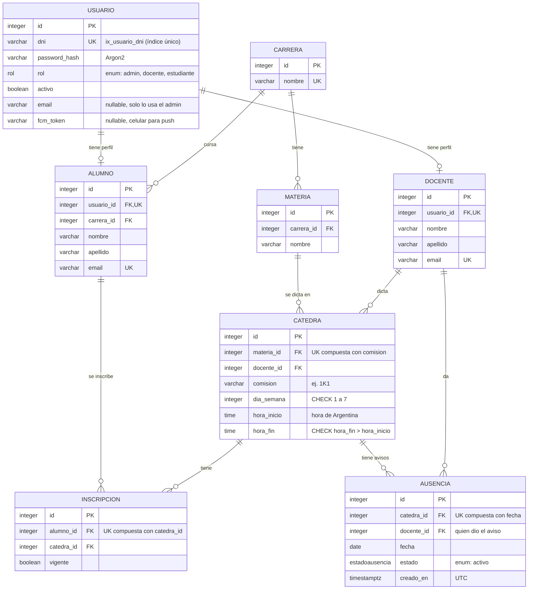
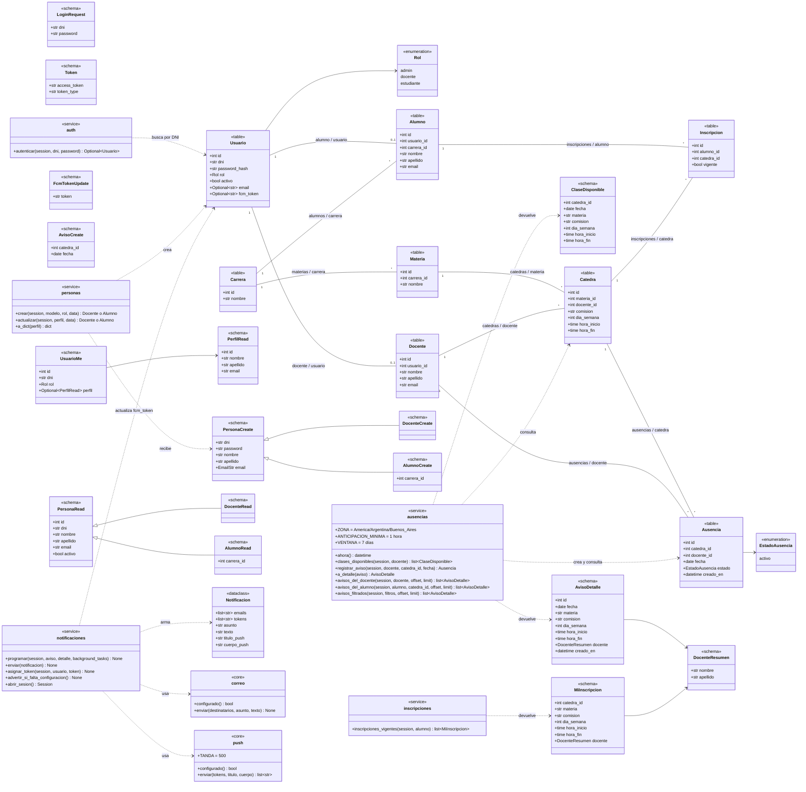
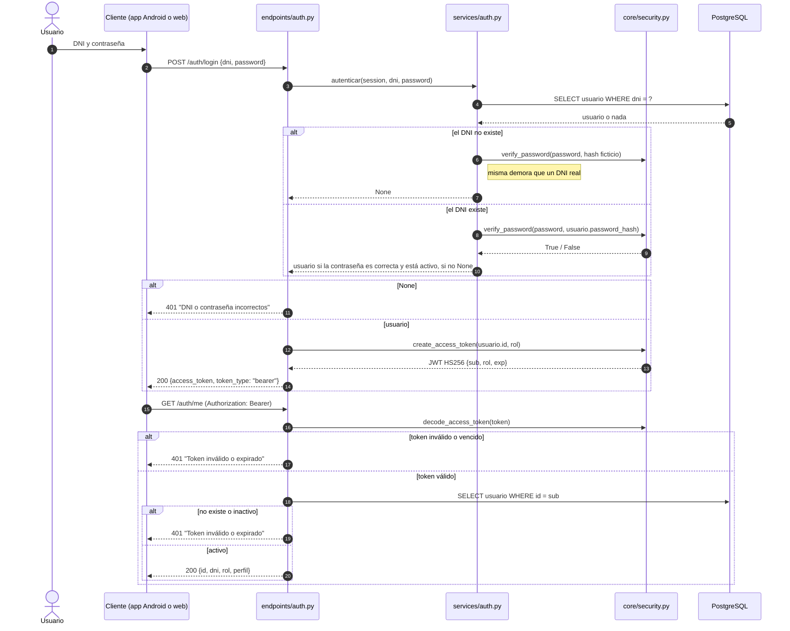
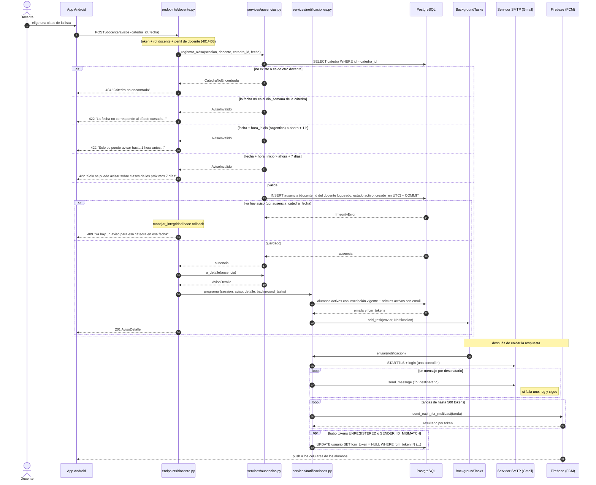
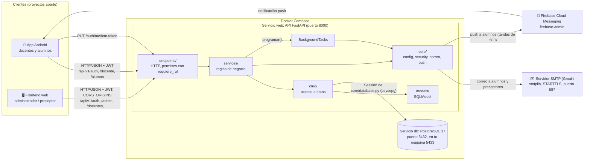

# Diagramas

Diagramas en Mermaid hechos a partir del código (`app/models`, `app/schemas`, `app/services`, `app/core`) y del esquema real de la base (migraciones de `alembic/versions`).

## Índice

1. [Diagrama entidad-relación (DER)](#1-diagrama-entidad-relación-der)
2. [Diagrama de clases](#2-diagrama-de-clases)
3. [Secuencia: login](#3-secuencia-login)
4. [Secuencia: el docente registra un aviso](#4-secuencia-el-docente-registra-un-aviso)
5. [Componentes](#5-componentes)

---

## 1. Diagrama entidad-relación (DER)

Tipos de PostgreSQL. `PK` es clave primaria, `FK` clave foránea y `UK` único de una sola columna. Todas las columnas son `NOT NULL`, salvo las marcadas como "nullable".

### Restricciones

Nombres tal como están en la base. Los generan las `naming_convention` de `app/models/__init__.py`.

| Tabla | Restricción | Tipo | Definición |
|-------|-------------|------|------------|
| todas | `pk_<tabla>` | PRIMARY KEY | `(id)`, entero autoincremental |
| `usuario` | `ix_usuario_dni` | UNIQUE INDEX | `(dni)` |
| `docente` | `uq_docente_usuario_id` | UNIQUE | `(usuario_id)`: relación 1 a 1 con `usuario` |
| `docente` | `uq_docente_email` | UNIQUE | `(email)` |
| `docente` | `fk_docente_usuario_id_usuario` | FOREIGN KEY | `usuario_id → usuario.id` |
| `alumno` | `uq_alumno_usuario_id` | UNIQUE | `(usuario_id)`: relación 1 a 1 con `usuario` |
| `alumno` | `uq_alumno_email` | UNIQUE | `(email)` |
| `alumno` | `fk_alumno_usuario_id_usuario` | FOREIGN KEY | `usuario_id → usuario.id` |
| `alumno` | `fk_alumno_carrera_id_carrera` | FOREIGN KEY | `carrera_id → carrera.id` |
| `carrera` | `uq_carrera_nombre` | UNIQUE | `(nombre)` |
| `materia` | `fk_materia_carrera_id_carrera` | FOREIGN KEY | `carrera_id → carrera.id` |
| `catedra` | `uq_catedra_materia_comision` | UNIQUE | `(materia_id, comision)` |
| `catedra` | `ck_catedra_dia_semana` | CHECK | `dia_semana BETWEEN 1 AND 7` (1 = lunes … 7 = domingo) |
| `catedra` | `ck_catedra_horario` | CHECK | `hora_fin > hora_inicio` |
| `catedra` | `fk_catedra_materia_id_materia` | FOREIGN KEY | `materia_id → materia.id` |
| `catedra` | `fk_catedra_docente_id_docente` | FOREIGN KEY | `docente_id → docente.id` |
| `inscripcion` | `uq_inscripcion_alumno_catedra` | UNIQUE | `(alumno_id, catedra_id)` |
| `inscripcion` | `fk_inscripcion_alumno_id_alumno` | FOREIGN KEY | `alumno_id → alumno.id` |
| `inscripcion` | `fk_inscripcion_catedra_id_catedra` | FOREIGN KEY | `catedra_id → catedra.id` |
| `ausencia` | `uq_ausencia_catedra_fecha` | UNIQUE | `(catedra_id, fecha)`: un aviso por clase |
| `ausencia` | `fk_ausencia_catedra_id_catedra` | FOREIGN KEY | `catedra_id → catedra.id` |
| `ausencia` | `fk_ausencia_docente_id_docente` | FOREIGN KEY | `docente_id → docente.id`: quien dio el aviso. No cambia si la cátedra se reasigna. |

- Las claves foráneas no tienen `ON DELETE`: borrar una fila referenciada falla, y la API responde `409`.
- Los valores por defecto (`activo = true`, `vigente = true`, `estado = 'activo'`, `creado_en = ahora en UTC`) los pone la aplicación, no la base.

### Tipos enumerados

| Tipo PostgreSQL | Valores | Enum de Python |
|-----------------|---------|----------------|
| `rol` | `admin`, `docente`, `estudiante` | `app.models.usuario.Rol` |
| `estadoausencia` | `activo` | `app.models.ausencia.EstadoAusencia` |

---

## 2. Diagrama de clases

Modelos (tablas), schemas principales (entrada y salida de la API) y services y módulos de `core` con sus funciones públicas. Los services son módulos de Python, no clases: se muestran con el estereotipo `«service»`.

`avisos_filtrados` recibe como parámetros keyword `carrera_id`, `materia_id`, `comision`, `docente_id`, `fecha_desde` y `fecha_hasta`, todos opcionales.

---

## 3. Secuencia: login

`POST /api/v1/auth/login` y después `GET /api/v1/auth/me` (HU-01).

---

## 4. Secuencia: el docente registra un aviso

`POST /api/v1/docente/avisos` (HU-02) con las notificaciones de HU-06. La autenticación (paso 2) es la misma del diagrama anterior: `get_current_user` y `requiere_rol(Rol.docente)`.

Si falla la preparación (`programar`) o cualquier envío (`enviar`), el error se registra en el log y el aviso queda creado igual. Si no hay SMTP o Firebase configurados, ese envío se saltea con un warning.

---

## 5. Componentes

| Componente | Tecnología | Notas |
|------------|------------|-------|
| API | FastAPI + SQLModel, Python | Servicio `web` de `docker-compose.yml`. Al arrancar corre `alembic upgrade head`. |
| Base de datos | PostgreSQL 17 | Servicio `db`. Datos en el volumen `pgdata`. |
| App Android | Proyecto aparte | Docentes y alumnos. Recibe push por FCM. |
| Frontend web | Proyecto aparte | Solo `admin`. Su origen va en `CORS_ORIGINS`. |
| Servidor SMTP | `smtplib` (biblioteca estándar) | `SMTP_HOST`, `SMTP_PORT`, `SMTP_USER`, `SMTP_PASSWORD`, `SMTP_FROM`. |
| Firebase | `firebase-admin` | `FIREBASE_CREDENTIALS`: ruta al JSON del service account dentro de `secrets/`, fuera de git. |
